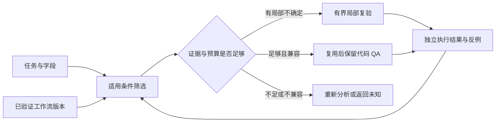

# IEEE Transactions 近两年记忆论文与 AutoSpider 适配评估

检索与代码复核日期：2026-11-15。

**结论：能借鉴，优先补“执行结果驱动的记忆更新、带适用条件的经验检索、预算内复验”。当前不建议直接用知识图谱或通用向量记忆库替换现有 Site Memory。** 这几个方向对应当前源码和受控诊断中仍存在的缺口；论文在别的任务上的效果，不是 AutoSpider 已改善的证据。

本轮核验了 **9 篇 IEEE Transactions 期刊论文：7 篇方法论文、2 篇综述**。其中 2025—2026 指正式卷期/期刊年份，截至 2026-11-15 可核验的记录；另标注首次在线和预印本时间。若严格要求“首次在线必须在 2025 年以后”，应将 P03 JARVIS-1 从该子集移出。

## 1. 文件与阅读顺序

- [PAPERS.md](PAPERS.md)：九篇论文的完整题名、DOI、公开版本、阅读深度、机制和迁移边界。
- [IMPLEMENTATION_AND_EVALUATION.md](IMPLEMENTATION_AND_EVALUATION.md)：建议的代码改进、研究问题、强基线与验收协议；**尚未实施**。
- [VERIFIED_REFERENCES.json](VERIFIED_REFERENCES.json)：Crossref 精确 DOI 元数据、出版方链接和核验范围。
- [references.bib](references.bib)：可导入 Zotero 等工具的九条期刊参考文献。
- [PROJECT_MEMORY_RECHECK.json](PROJECT_MEMORY_RECHECK.json)：用当前生产组件完成的隔离诊断复跑，不读取用户记忆库。

建议先读 P01 Meta-Memory、P02 FinMem、P03 JARVIS-1，再读 P04 LMAgent 的消融；只有当检索的跨事件关系确有价值时，再深入 P05/P07 的结构化记忆。

## 2. 论文清单与项目适配

下表的适配优先级是结合项目源码做出的工程判断，不是论文给 AutoSpider 做过的测试。每个链接直接指向出版方 DOI；公开方法版本见 PAPERS。

| ID | 论文 | IEEE 期刊与卷期 | 可借鉴部分 | 对项目的判断 |
| --- | --- | --- | --- | --- |
| P01 | [Meta-Memory for Large Language Models](https://doi.org/10.1109/TASLPRO.2026.3692286) | Transactions on Audio, Speech and Language Processing，2026，34:2774–2787 | 记忆学习、构建、冲突更新、按需检索 | 优先读；更新判定须接代码证据，不照搬模型自信 |
| P02 | [FinMem: A Performance-Enhanced LLM Trading Agent With Layered Memory and Character Design](https://doi.org/10.1109/TBDATA.2025.3593370) | Transactions on Big Data，2025，11(6):3443–3459 | 不同寿命的记忆分层、相关性/时效/重要性排序 | 优先借鉴；规则时效不同于金融信息时效 |
| P03 | [JARVIS-1: Open-World Multi-Task Agents With Memory-Augmented Multimodal Language Models](https://doi.org/10.1109/TPAMI.2024.3511593) | Transactions on Pattern Analysis and Machine Intelligence，2025，47(3):1894–1907 | 将任务、环境状态、成功执行计划一起保存与检索 | 优先借鉴；当前只有站点/计划摘要，条件与执行经验不足 |
| P04 | [LMAgent: A Large-Scale Multimodal Agents Society for Multi-User Simulation](https://doi.org/10.1109/TMM.2026.3651078) | Transactions on Multimedia，2026，28:2668–2680 | 高频简单行为走记忆快路径，复杂行为再调用模型 | 适合减少重复分析；项目已有部分同类设计，需证明新增收益 |
| P05 | [GCAgent: Long-Video Understanding via Schematic and Narrative Episodic Memory](https://doi.org/10.1109/TMM.2026.3724344) | Transactions on Multimedia，2026，28:15084–15096 | 结构化事件与事件序列，结合局部证据和全局过程 | 适合探索失败—修复过程记忆；不能把叙事关系当因果证明 |
| P06 | [Memory-Augmented Architecture for Long-Term Context Handling in Large Language Models](https://doi.org/10.1109/TAI.2026.3701680) | Transactions on Artificial Intelligence，2026，7(10):5830–5837 | 相关性检索和裁剪，对照 LRU | 更适合作为常规强基线；不解决选择器正确性 |
| P07 | [Empowering Large Language Models to Set Up Knowledge Retrieval Indexing via Self-Learning](https://doi.org/10.1109/TKDE.2025.3649907) | Transactions on Knowledge and Data Engineering，2026，38(3):1710–1724 | PG 索引组织文档内外联系，按相关子图取证 | 与图谱方向相关；索引成本和自动建边错误必须计入 |
| P08 | [Lifelong Learning of Large Language Model Based Agents: A Roadmap](https://doi.org/10.1109/TPAMI.2025.3650546) | Transactions on Pattern Analysis and Machine Intelligence，2026，48(5):5552–5571 | 感知、记忆、行动的持续适应与评估框架 | 用于研究设计；是综述，不是可直接复现的单一新算法 |
| P09 | [A Survey on Autonomy-Induced Security Risks in Large Model-Based Agents](https://doi.org/10.1109/TPAMI.2026.3688650) | Transactions on Pattern Analysis and Machine Intelligence，2026，48(10):11382–11401 | 记忆生命周期、污染与跨模块风险 | 补充可信度边界；不作为成功率改善算法证据 |

日期要点：P02 期刊在线日期为 2025-08-04，公开预印本已有 2023 年版本；P03 在线日期为 2024-12-05，公开预印本始于 2023 年；P04 预印本始于 2024-12，但期刊在线为 2026-01-12；P07 在线为 2025-12-31，正式卷期为 2026-03。**DOI 中的年份不能代替发表日期。** [FinMem 作者公开期刊稿](https://suchow.io/assets/docs/yu2024finmem.pdf)、[JARVIS-1 出版方记录](https://ieeexplore.ieee.org/document/10778628/)、[LMAgent 出版方记录](https://ieeexplore.ieee.org/abstract/document/11329188/authors)、[PGRAG 出版方记录](https://ieeexplore.ieee.org/abstract/document/11320578)。

## 3. 你的记忆系统目前到底是什么

现有主链路是**已验证采集工作流的 SQLite 记忆与复用**，不是一个已经具备通用经验学习和知识图谱推理的系统。它已经有有价值的基础：

- 保存站点、PageModel、字段选择器、工作流和关联 task。
- 通过 `memory_lookup_site` 返回小型元数据，通过 `crawl_reuse_workflow` 复用。
- 复用器校验同 scheme/authority/path、字段覆盖、API 与固定请求参数的兼容性。
- 服务内部样本 QA、全量 QA；自动草稿满足完整验证条件才提交记忆。
- 常规路径不向模型重复发送完整计划与正文。

因此不能把“新增一个记忆库”当成从无到有。需要补的是：失败如何影响旧记忆、环境变更后还适不适用、修复过程怎样可复用，以及质量门槛能否看见真正错误。

关键代码：

| 位置 | 当前行为 |
| --- | --- |
| [repository.py](../../../packages/site_memory/repository.py) | 站点/选择器/工作流持久化与排序 |
| [similarity.py](../../../packages/site_memory/similarity.py) | 结构指纹相同为 1，否则为 0，不是语义向量相似度 |
| [reuse.py](../../../packages/crawl_core/reuse.py) | 兼容性检查及 Spec/Plan 的确定性适配 |
| [server.py](../../../services/easyspider_mcp/server.py) | 精简记忆查询、工作流复用、QA 与自动提交门禁 |
| [semantic.py](../../../packages/validator/semantic.py) | 类型、日期、URL、可疑常量等检查；不是一般正文真值判定器 |

## 4. 当前代码中仍存在的四类问题

### 4.1 失败尚未闭环到工作流可靠性

`lookup_workflows()` 按 `success_rate DESC, last_success_at DESC` 排序。但是 `commit_validated()` 实际把一次 `validation_score` 写入 `success_rate`。它不是按成功/失败执行次数计算出的历史成功率。

`record_failure()` 有失败日志 API，但插入时没有 workflow 绑定参数，也不调整工作流得分；在本次静态检查范围 `packages/`、`services/` 内没有找到对该 API 的调用点。不能因为 schema 中有 failure_count/failures，就认为生产已经实现失败经验学习。

2026-11-15 的隔离复跑：临时库中工作流得分 0.95，手工记录一次失败后仍为 0.95、仍排第一，失败记录关联 workflow 的数量为 0。这个实验**没有证明生产曾自动写回失败，也没有执行真实采集或证明模型实际再次选错**；它证明日志本身不改变当前排序与范围。见 [本次证据](PROJECT_MEMORY_RECHECK.json)。

**适配：** 借 P01 的更新/校准思路、P02 的时效管理，先接确定性执行结果。将 QA 分数与经验可靠性拆开，按工作流版本、字段与任务范围记录可归因结果。503、DNS 或访问策略阻断不能直接当作选择器错误去永久降级。

### 4.2 非空错误正文仍可能通过 QA

隔离复跑用十条各不相同的“错误区域文字”替代正文，`validate_records()` 仍返回 PASS、`semantic_score=1.0`。另一个十条中两条正文为空的案例也 PASS；后者与当前允许每字段最高 20% 空值的规则一致，是“每条都要完整”的任务期望与规则的差距，不能描述为随机故障。

**适配：** P03 支持把任务与当前状态一起检索，P05/P07 支持组织证据关系；但它们都没有证明能判断你这类网页正文归属。需要增加任务实体、字段与候选区域的独立来源证据，并保留“证据不足”。仅有同域、非空、相似结构或模型自信，不能据此给旧规则通行。

这是一个由验证缺口传递到记忆入库与复用的问题，不是单独替换数据库就能解决的问题。

### 4.3 检索的任务条件不充分，但现有防护不能被忽略

当前 workflow 查询主要按 domain，返回前三个及推荐项；page 查询按时间排序并附二值指纹信息。执行阶段虽有路径/字段/API 参数检查，但没有完成一般意义上的“页面变了，旧规则仍指向的是不是用户要的区域”验证。

不能再把已经防住的固定 API/导航参数变化当新发现。2026-10-26 的研究已核对，旧的“同值参数被全局替换”假设未在所测范围成立；真实剩余风险是在受控栏目变化中，旧规则落入非空推荐区仍被接受。见 [参数核验](../../patent/parameter-binding-2026-10-26/README.md)。

**适配：** P03 的状态条件检索可转化为“任务字段 + 传输方式 + 路由 + 已观察结构/来源条件”的候选过滤，之后再评分；不能让向量近邻绕过现有硬兼容性检查。

### 4.4 规则记忆与修复过程经验还没有充分连接

当前高价值的可复用对象主要是成功工作流与选择器；历史聊天或日志里出现过的“失败页、错误字段、尝试过什么、为什么修正后通过”，不等于已经形成下一次可检索的结构化经验。

**适配：** P03/P05 的经验单元可用于保存有证据的最小过程：前提、失败、改动、验证结果和适用范围。P04 的快路径用于避免再次让模型解释相同稳定步骤。此处先用关系表/JSON 即可，只有当关系查询确实带来收益再增加图表示。

成本也不是全归因于记忆。当前已经有 compact tools、摘要和成功探针裁剪；模型定义、系统提示、背景调用、提供方错误同样会影响用量。不能承诺修改记忆就解决全部失败或 API 开销。

## 5. 最值得落地的三个方向

### 方向 A：带执行反馈的工作流记忆更新——优先实施

**研究问题：** 在网页规则可能变化、网络故障又常常暂时发生的情况下，怎样让失败影响正确的旧规则，同时保留仍有效的工作流，减少下一次重复试错？

具体补齐：分离 QA score 与历史可靠性；将终态事件绑定 workflow/version/execution/字段/范围；区分选择器、质量、网络、策略、内部错误；旧规则转待复验后以新的独立验证恢复。事件要幂等，重复读取或重复角色转述不能算多次支持证据。

**可期待但待验证的收益：** 同一已确认坏规则的重复采纳次数下降；一次临时 503 不造成长期误封；恢复后正常规则仍能复用。需要与普通失败计数、TTL、按错误码状态机比较，不能只胜过“完全不更新”的弱基线。

### 方向 B：带任务条件与反例的复用前验证——重要但难度更高

**研究问题：** 当旧选择器仍有非空结果时，怎样在有限取证预算内识别“取到另一个栏目/实体/区域”，避免错误规则被缓存成经验？

候选对象保存任务绑定、字段来源、验证时观测和已知反例；查询只在相同有效范围复用。来源证据缺失时返回待核验，不把未发现问题说成已证明正确。受控数据的真值只能用于评分，不能提供给检索/验证策略。

**现有负结果必须保留：** 早先完整投影缓存与候选机制等价；图/非图的历史反例方案也逐项等价，并有共同失效。新增机制必须在同信息、同预算、同候选条件下胜过这些强基线。见 [v2](../../patent/memory-v2-2026-10-19/RESULTS.md)、[适用性研究](../../patent/selector-applicability-2026-10-26/README.md)。

### 方向 C：有界修复经验检索与共享——以降低重复模型分析为目标

**研究问题：** 能否将经过执行验证的修复过程压缩成下一次可用的少量经验，在不增加错误迁移的条件下减少模型调用与重复上下文？

保存的是“有适用条件的做法”，不是把某站选择器直接推广到另一站。由主控提交，分析/QA 角色提供候选，完整代码验证通过才升级为可执行工作流；叙述性反思仍只是待验证建议。先比较结构化表、BM25/向量检索、简单最近案例；多智能体只转述同一证据，不增加可信度计数。

P04 的 fast memory 与项目现有服务内复用有重叠，所以“少调模型”本身不是新机制。候选新增经验层必须测出比现有 compact/reuse 更少的总调用、总 tokens 或费用，且成本包含入库、索引与检索。

## 6. 知识图谱是否值得上

可以采用轻量的“任务—字段—候选区域—规则版本—验证事件”关系表示，但图只负责组织与查询。它不能凭节点/边自动赋予内容正确性、因果关系或适用性。

第一版用 SQLite 关系表和 JSON 就能表达上述关系。只有在多次依赖追踪、跨过程证据连接或多跳检索任务上，图检索实测优于同信息关系查询时，再引入图算法/图数据库。否则是有用的工程表示，不宜把图本身说成性能或创新来源。

## 7. 论文证据不等于本项目效果

P04 的公开稿在其仿真中报告约 40% tokens 降低，同时平均购买准确率有 0.28 个百分点下降；不能承诺 AutoSpider 也节省 40%。P05 的长视频记忆摘要可显著变短，但短视频摘要反而变长，且摘要长度不包含整个构建流程费用。P06 的裁剪在一个模型中相对不裁剪略降准确率。它们共同说明应评估质量—成本取舍。[LMAgent 消融](https://arxiv.org/html/2412.09237v2)、[GCAgent token 分析](https://arxiv.org/html/2511.12027v1)、[相关性裁剪结果](https://arxiv.org/html/2506.18271v1)。

本轮证据只支持：①选定论文真实有对应期刊记录；②当前隔离案例中的缺口仍可复现；③存在明确可实现的适配点。**本轮没有实现这三个改进、没有改生产 SQLite 或执行权限、没有运行付费模型，更没有测得真实网站成功率或费用改善。**

## 8. 检索与核验方法

使用 `nature-academic-search` 的多源检索与 DOI 核验流程。当前没有专用学术 MCP 工具，采用 Crossref 官方 REST 精确 DOI 查询、IEEE Xplore 出版方记录、arXiv 作者稿及作者机构页面；只将第一手来源作为技术结论依据。

筛选词组合覆盖 `memory / episodic memory / long-term memory / memory-augmented / agent / large language model / multi-agent` 与 IEEE Transactions。另查询 Crossref IEEE member:263、journal-article、2025-01-01 至 2026-11-15 的相关记录，人工排除硬件内存、模型权重/KV cache、仅 LSTM/传统 MARL 等不对题结果。不是系统综述级穷尽检索，不用搜索命中数表示领域论文总数。

IEEE 部分页面返回 JS/机器人检查，未绕过。所有入选条目的期刊归属均另由出版方提交的 Crossref 精确 DOI 元数据核验；方法解读使用明确列出的公开稿/机构介绍。**没有把预印本逐页核成期刊最终稿，也不把未读到的期刊全文说成已精读。**

容易误纳而已排除：

- `LSTM-MAS`：公开作者稿出现 TNNLS 字样，但本轮未核得相符期刊 DOI/出版记录；不进入九篇已核验清单。[作者预印本](https://arxiv.org/abs/2601.11913)。
- `A Survey on the Memory Mechanism of Large Language Model-Based Agents` 是 ACM TOIS，不能算 IEEE Transactions。
- `MetaMem` 与本文 P01 `Meta-Memory` 不是同一论文；不能把 ACL Findings 的 MetaMem 标成 IEEE TASLP。
- `MemoryBank`、A-MEM、MemGPT、HiAgent 等可作为扩展对照，但不在本次 IEEE Transactions 主清单内。
- IEEE Access、ICRA/IROS/SaTML 等会议与其他非 Transactions 资料只作补充，不拿来凑期刊数量。

## 9. 建议的下一步

先实现方向 A 的最小生产闭环，并以当前缺口和暂时网络失败做回归；通过后再增加方向 C 的小型经验检索。方向 B 作为更窄研究问题，需要真正区分错误区域的独立证据，并与既有强基线公平比较。

论文可提供工程机制和基线，但把分层、检索、图表示、反思组合起来，本身不构成已证明的新技术贡献。若后续仍以专利为目标，应保留本轮出处与负结果，等具体机制、强基线差异和技术效果都得到证据后，再整理交底。
