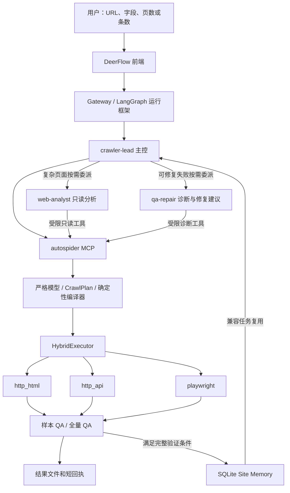

# AutoSpider 多智能体项目交接与运行指南（交给 Work Buddy）

整理日期：2026-11-14。依据：当前项目源码、实际配置、安装模板和已有验收记录。

2026-11-15 GitHub 版补充：项目现采用一个仓库管理 AutoSpider 与定制 DeerFlow 源码，双机操作见 [GitHub 同步指南](../docs/GITHUB_WORKFLOW.md)。新 clone 不包含下文列出的原机实际配置、数据库和运行数据；需要按安装流程生成配置，填写本机密钥并重绑路径。本文原机基线与历史数据位置保留原日期。

原电脑项目位置：`D:\VsCode\syslabe\AutoSpider`。另一台电脑可以使用其他目录，下文以 `$ProjectRoot` 表示**新电脑解压后的实际根目录**。本指南按 Windows + PowerShell 编写。

本文件用于让 Work Buddy 接手项目、恢复运行并继续维护。Work Buddy 是接手开发与部署的助手；项目运行时的主智能体仍然是 DeerFlow 中的 `crawler-lead`。把本文件交给 Work Buddy，不会自动把项目 MCP 注册到 Work Buddy 自身。

> 本次只编写交接文档，并在原机做静态核对、离线冒烟、隔离 stdio MCP 握手和 Chromium 本地启动检查；没有在另一台电脑上执行安装，也没有调用付费模型验收。项目已经提前压缩发送，本文件需要再单独发送给接手方。

## 目录

1. [交接结论与当前状态](#1-交接结论与当前状态)
2. [项目目标与整体架构](#2-项目目标与整体架构)
3. [目录和代码入口](#3-目录和代码入口)
4. [多智能体分工](#4-多智能体分工)
5. [Tools、MCP、Skills 的关系](#5-toolsmcpskills-的关系)
6. [MCP 服务与全部工具](#6-mcp-服务与全部工具)
7. [六个采集 Skills](#7-六个采集-skills)
8. [任务协议与执行链](#8-任务协议与执行链)
9. [记忆、数据和配置位置](#9-记忆数据和配置位置)
10. [新电脑安装与迁移步骤](#10-新电脑安装与迁移步骤)
11. [启动、访问与停止](#11-启动访问与停止)
12. [分层验收](#12-分层验收)
13. [失败诊断与自动修复](#13-失败诊断与自动修复)
14. [API 消耗与运行约束](#14-api-消耗与运行约束)
15. [常见故障排查表](#15-常见故障排查表)
16. [继续开发与研究的边界](#16-继续开发与研究的边界)
17. [可直接交给 Work Buddy 的任务说明](#17-可直接交给-work-buddy-的任务说明)

## 1. 交接结论与当前状态

| 项目 | 当前实际情况 |
| --- | --- |
| 项目 | AutoSpider，包名 `autospider-agent`，版本 `0.1.0` |
| 智能体框架 | 项目内的 `deer-flow/`，含本项目的定制修改 |
| 项目爬虫角色 | 3 个：`crawler-lead`、`web-analyst`、`qa-repair` |
| 已启用项目 MCP 服务 | 1 个：`autospider` |
| AutoSpider MCP 工具 | 28 个；DeerFlow 调用时加 `autospider_` 前缀 |
| 主控常用 MCP 工具 | 预绑定 6 个，其余按需发现 |
| 项目维护的采集 Skills | 6 个，源文件在 `deerflow/skills/` |
| 默认执行方式 | 原生混合执行器：HTTP HTML、公开 JSON API、Playwright |
| EasySpider 桌面程序 | 默认链路不需要启动；8074 不是默认运行依赖 |
| Scrapling MCP | 此次核对时尚未安装、注册或接入，不计入服务数量 |
| 默认模型配置 | 当前 YAML 选择 `glm-5.3`；是否可用取决于新机器的密钥、网络和服务额度 |
| 本机运行方式 | 原生 Windows 前后端分端口启动，不依赖 nginx、Docker、WSL |
| 推荐交接访问端口 | 前端显式用 3001，Gateway 用 8001；现有启动脚本的默认前端端口实际是 3000 |

上述 MCP 数量是**这个项目配置中的数量**，不是 Codex、Work Buddy 或其他客户端各自的 MCP 总数。角色数、服务数、工具数也不能互相等同。

原机核对到的环境基线：

| 组件 | 原机版本或约束 |
| --- | --- |
| AutoSpider Python | 实际 3.11.15；项目要求 `>=3.11` |
| DeerFlow 后端 Python | 实际 3.12.7；后端要求 `>=3.12`，`.python-version` 为 `3.12` |
| MCP Python SDK（AutoSpider 环境） | 1.26.0 |
| Playwright（AutoSpider 环境） | 1.60.0 |
| Pydantic / HTTPX（AutoSpider 环境） | 2.12.5 / 0.28.1 |
| Node.js | 实际 v22.22.2；项目检查要求 22+ |
| pnpm | `frontend/package.json` 固定 `pnpm@10.26.2` |
| uv | 原机 0.11.7；后端依赖使用其现有锁文件安装 |

原机 AutoSpider 解释器是 `D:\conda_envs\mytorch\python.exe`。这不是新电脑天然具备的路径。`mytorch` 是历史环境名，运行爬虫本身不要求安装 PyTorch 或配备 GPU。

## 2. 项目目标与整体架构

用户提供网址和自然语言需求，例如“采集某个新闻栏目前两页的标题、链接、发布时间、正文”。系统负责分析页面、验证选择器、选择传输方式、生成受约束计划、执行采集、进行确定性质量检查，并保存可复用的站点工作流。



运行时的大模型主要做需求理解、证据判断和参数选择。常规爬取不依靠大模型临时编写、运行任意 Python 爬虫；执行器按受约束的计划运行固定代码。编译、数据检查和文件输出主要由代码完成。

传输选择优先采用已经验证可用的公开稳定 API，其次服务器返回的 HTML，最后是确实需要 JavaScript 或交互的浏览器。这个顺序受证据和访问策略约束，并不意味着每个网站都先猜接口，也不保证任何网站都能成功采集。

## 3. 目录和代码入口

**首先分清 `deerflow/` 与 `deer-flow/`：前者是本项目的配置模板，后者是实际运行的框架仓库。**

```text
AutoSpider/
├── README.md                         项目总览
├── UPSTREAM.lock                     已核对的上游版本记录
├── pyproject.toml                    AutoSpider Python 包及依赖
├── .env.example                      AutoSpider 配置变量示例
├── packages/
│   ├── crawl_core/                   类型模型、计划、草稿、策略、复用、CLI
│   ├── compiler/                     CrawlPlan 编译；含旧 EasySpider 兼容代码
│   ├── executor/                     HTTP / Playwright / 混合执行与持久任务
│   ├── inspector/                    HTTP 总览、DOM、浏览器与网络证据
│   ├── validator/                    确定性 QA、分层字段检查、修复模型
│   └── site_memory/                  SQLite 站点与工作流记忆
├── services/
│   ├── autospider_mcp/server.py       对外 MCP 入口
│   └── easyspider_mcp/                当前主要服务实现和历史适配器所在位置
├── schemas/                          五类主要模型的 JSON Schema
├── deerflow/                         本项目维护的部署源模板
│   ├── agents/                       主控与两个专业角色
│   ├── skills/                       六个采集 Skills
│   ├── extensions_config.json        MCP 与 Skill 开关模板
│   └── config.autospider.patch.yaml  DeerFlow 配置补丁
├── deer-flow/                        实际 DeerFlow 框架及本地定制
│   ├── config.yaml                   生效模型、工具、子智能体等配置
│   ├── extensions_config.json        生效 MCP 配置，含绝对路径
│   ├── .env                          模型密钥等本机环境变量
│   ├── .deer-flow/                   当前脚本指定的用户资源 HOME
│   ├── backend/                      Python Gateway 与 harness
│   └── frontend/                     Next.js 前端
├── data/site_memory.db               AutoSpider 站点工作流记忆
├── runtime/                          采集任务、执行、结果、日志与研究产物
├── scripts/                          安装、启动、自检、验收、审计脚本
├── tests/                            AutoSpider 单元和本地页面 E2E 测试
├── docs/                             实现说明、修复记录、实验与专利研究
├── markdown/                         汇报、交接与专利初稿
└── EasySpider/                       历史对比和兼容上游，不是默认启动依赖
```

接手时优先阅读：

| 关注点 | 文件 |
| --- | --- |
| 安装模板如何写入实际配置 | [`scripts/bootstrap.py`](../scripts/bootstrap.py) |
| Windows 后台启动 | [`scripts/start_deerflow_windows.ps1`](../scripts/start_deerflow_windows.ps1) |
| 模型切换 | [`scripts/configure_llm.py`](../scripts/configure_llm.py) |
| 主控行为 | [`deerflow/agents/crawler-lead/SOUL.md`](../deerflow/agents/crawler-lead/SOUL.md) |
| 主控工具和预算 | [`deerflow/agents/crawler-lead/config.yaml`](../deerflow/agents/crawler-lead/config.yaml) |
| MCP 工具实现 | [`services/easyspider_mcp/server.py`](../services/easyspider_mcp/server.py) |
| 草稿、协议、计划 | [`packages/crawl_core/`](../packages/crawl_core/) |
| 质量验证 | [`packages/validator/`](../packages/validator/) |
| 最近的失败与消耗诊断 | [`docs/AGENT_DIAGNOSIS_2026-11-01.md`](../docs/AGENT_DIAGNOSIS_2026-11-01.md) |

`services/autospider_mcp/server.py` 当前从 `services.easyspider_mcp.server` 导入 `main` 与 `mcp`。看到旧模块名不代表系统又接入了第二个 MCP，也不代表默认还在运行 EasySpider 二进制。

## 4. 多智能体分工

### 4.1 crawler-lead：唯一执行编排者

负责保留用户原始字段与范围、查记忆、选择直接分析或委派、创建草稿、执行、处理失败并交付文件。

- 使用 `prompt_profile: crawler_compact`，减少通用提示词和无关工具开销。
- 普通工具允许项：`task`、`ask_clarification`、`present_files`、`read_file`、`describe_skill`。
- 直接绑定六个紧凑 MCP 工具，常规爬取无需先搜索工具。
- 允许委派 `web-analyst` 和 `qa-repair`。
- 角色配置启用 200,000-token 单轮预算；全局 YAML 的 `token_budget.enabled=false` 不代表这个专用角色没有预算。
- `thinking_enabled=false` 且锁定该角色开关；模型提供方的实际能力仍取决于模型配置。

`force_subagent_enabled: true` 保证该角色的委派能力开启，不应被理解为每个任务都必须调用两个子智能体。

### 4.2 web-analyst：只读结构与传输分析

分析重复列表块、字段位置、详情链接、分页链接和必要的 XHR/fetch 证据，返回精简、已验证的参数建议。不得注册或启动采集任务。

- 当前允许 9 个 MCP 工具：8 个探测/选择器工具，加 `memory_lookup_site`。
- Skills：`webpage-analysis`、`selector-engineering`、`transport-selection`。
- 模型：`inherit`，即继承主控所用模型配置，不是固定另一个厂商。
- 当前角色上限：12 turns、300 秒。

### 4.3 qa-repair：质量诊断与最小修复

检查结果、日志、失败字段和实际失败页，对选择器或计划提出最小修改。不得注册任务或启动全量采集，也不直接手改编译后的任务。

- 当前允许 7 个工具：结果摘要、执行 QA、日志、HTTP 选择器探针、浏览器选择器/快照和记录 QA。
- Skills：`crawl-validation`、`selector-engineering`。
- 模型：`inherit`。
- 当前角色上限：10 turns、300 秒。
- 必填字段提取可能在 QA 报告生成前失败。遇到 `needs_repair/selector_no_match` 也应诊断，不能只等 `validation.status=FAIL`。

当前全局 `subagents.max_total_per_run=2`。这是每次运行的总委派限制，不能据此承诺三个角色持续并行或任意次数修复。简单任务、兼容记忆任务可能全程由主控完成。

两个子角色的提示词源文件在 `deerflow/agents/*/SYSTEM.md`，`bootstrap.py` 会把内容写入实际 `deer-flow/config.yaml -> subagents.custom_agents`。

## 5. Tools、MCP、Skills 的关系

| 概念 | 在本项目中的含义 | 示例 |
| --- | --- | --- |
| Agent | 决定下一步动作、承担具体职责的模型角色 | `crawler-lead` |
| Tool | 一次可被模型调用的函数能力 | 验证选择器、执行草稿、读取摘要 |
| MCP Server | 向 DeerFlow 提供一组工具的服务进程 | `autospider` |
| Skill | 包含使用时机、流程、限制及 `allowed-tools` 的操作知识包 | `crawl-validation/SKILL.md` |
| 执行器 | 按计划真正发请求或操作浏览器的代码 | `HTTPExecutor`、`PlaywrightExecutor` |
| QA | 检查已采集数据是否满足规范的代码与报告 | `ValidationReport` |

当前 `deer-flow/config.yaml` 还声明了 10 个通用工具：`web_search`、`web_fetch`、`image_search`、`ls`、`read_file`、`glob`、`grep`、`write_file`、`str_replace`、`bash`。框架会另行装配委派、澄清、文件展示、Skill 描述和工具发现等能力。因此不能把“28 个 MCP 工具”称为框架全部工具总数。

`crawler_compact` 的普通工具白名单会限制通用工具暴露；不是 YAML 中声明的 10 个工具都会交给爬虫主控。也不要为了让爬虫工作，直接开放 `bash` 或任意写文件来绕过受约束执行链。

模型最终能不能使用某个 MCP 工具，需要同时检查：

1. MCP 服务是否启用、进程能否启动、握手是否成功。
2. 工具是否被预绑定，或可经 `tool_search` 按需发现。
3. 当前角色或子角色是否允许使用。
4. 活动 Skill 的 `allowed-tools` 是否允许；该限制会影响发现和实际调用。
5. 工具参数、任务状态和网络访问策略是否满足合同。

所以“在 JSON 里加一个服务”不等于“全部角色已经会正确使用它”。修改 Skills 后只改模板也不够，必须同步当前用户实际安装的副本。

## 6. MCP 服务与全部工具

### 6.1 服务配置与生命周期

实际配置：`deer-flow/extensions_config.json -> mcpServers.autospider`。

当前使用 stdio：DeerFlow 通过指定 Python 解释器启动 `python -m services.autospider_mcp.server`，在标准输入/输出上传输 MCP 消息。它不是默认独立监听端口的 HTTP 服务。

- `tool_name_prefix=true`：服务内 `probe_http` 在模型侧显示为 `autospider_probe_http`。
- `session_init_timeout=60`：初始化等待秒数。
- `tool_call_timeout=1800`：MCP 调用超时配置；不等于每个采集任务必定运行 30 分钟。
- 服务级 `routing.mode=off`，记忆查询和复用工具有单独偏好配置。
- `tool_search.enabled=true`、`auto_promote_top_k=2`；Skills 使用延迟发现。

默认不必单独开 MCP 终端。手动 stdio 启动后“没有网页界面、一直等输入”是正常行为；直接运行不等于完成客户端握手。不要在协议 stdout 中随意添加调试 `print`。

### 6.2 六个预绑定工具

| DeerFlow 完整工具名 | 用途 |
| --- | --- |
| `autospider_memory_lookup_site` | 读取精简站点、字段、模式和已验证工作流元数据 |
| `autospider_crawl_reuse_workflow` | 服务内部重建兼容任务，样本验证后采集 |
| `autospider_probe_http` | 紧凑 HTTP 总览，找结构与真实链接证据 |
| `autospider_probe_http_select` | 在完整响应上验证 XPath/CSS，只返回计数和短样例 |
| `autospider_crawl_draft_create` | 用验证过的紧凑参数生成草稿 ID |
| `autospider_crawl_draft_execute` | 执行样本、QA、全量、最终 QA 和条件记忆提交 |

### 6.3 全部 28 个工具

以下使用**服务内名称**，在 DeerFlow 模型侧均加 `autospider_` 前缀。

| 分组 | 工具 | 用途 |
| --- | --- | --- |
| 探测 1/8 | `probe_open` | 打开受策略限制的只读浏览器探针会话 |
| 探测 2/8 | `probe_http` | 无浏览器 HTTP HTML/JSON 总览 |
| 探测 3/8 | `probe_http_select` | 完整 HTML 上验证字段选择器 |
| 探测 4/8 | `probe_snapshot` | 有界文本、DOM、链接、表单和按钮证据 |
| 探测 5/8 | `probe_network` | 有界、脱敏的 XHR/fetch 记录 |
| 探测 6/8 | `network_jsonpath_test` | 对已捕获 JSON 响应测试受限 JSONPath |
| 探测 7/8 | `probe_close` | 释放浏览器探针会话 |
| 探测 8/8 | `selector_test` | 在浏览器探针中验证 XPath/CSS |
| 计划执行 1/7 | `crawl_plan_build` | 严格 Spec/PageModel 转中间计划 |
| 计划执行 2/7 | `task_compile` | 确定性编译，不调用模型 |
| 计划执行 3/7 | `task_compile_register` | 编译并注册，减少中间 JSON 传递 |
| 计划执行 4/7 | `crawl_execute_validated` | 编译、注册、执行、等待和代码 QA |
| 计划执行 5/7 | `crawl_reuse_workflow` | 复用已验证工作流 |
| 计划执行 6/7 | `crawl_draft_create` | 从紧凑参数创建新站草稿 |
| 计划执行 7/7 | `crawl_draft_execute` | 草稿样本与全量闭环 |
| 生命周期 1/8 | `task_register` | 注册已经编译的任务 |
| 生命周期 2/8 | `task_get` | 读取任务 |
| 生命周期 3/8 | `execution_create` | 创建不可变参数的执行实例 |
| 生命周期 4/8 | `execution_start` | 启动执行实例 |
| 生命周期 5/8 | `execution_logs` | 读取状态、错误和进度，可等待终态 |
| 生命周期 6/8 | `execution_stop` | 停止执行 |
| 生命周期 7/8 | `execution_result` | 读取限定条数的结果 |
| 生命周期 8/8 | `execution_result_summary` | 读取短摘要、状态和输出路径 |
| QA 1/2 | `qa_validate` | 对给定记录做确定性验证 |
| QA 2/2 | `qa_validate_execution` | 在服务端读取执行结果并验证 |
| 记忆 1/3 | `memory_lookup_site` | 精简查询站点记忆 |
| 记忆 2/3 | `memory_get_workflow` | 高级诊断时读取一条完整工作流 |
| 记忆 3/3 | `memory_commit_validated` | 验证通过后保存工作流与规则 |

`task_id`、`execution_id`、`draft_id`、`workflow_id` 是不同对象，不能混用。高级工具仍在，但常规路径避免让模型读取完整 typed schema、计划和正文再逐项拼回去。

## 7. 六个采集 Skills

| Skill | 何时使用 | 主要内容 |
| --- | --- | --- |
| `intelligent-crawling` | URL + 自然语言采集需求的总体编排 | 保留需求、查记忆、紧凑新站流程、失败处理与完成条件 |
| `autospider-workflow` | 需要理解注册、执行、状态和草稿合同 | 确定性执行链及 ID、样本/全量、顺序重试约定 |
| `webpage-analysis` | 页面结构、字段或分页位置不清楚 | 重复块、详情、分页证据与短参数输出 |
| `selector-engineering` | 发现、验证或修复字段选择器 | XPath/CSS/JSONPath、相对作用域与最小修改 |
| `crawl-validation` | 样本/全量结果验证及失败诊断 | 质量、分层字段覆盖、失败 URL 和修复证据 |
| `transport-selection` | 判断 HTTP、API 或浏览器方式 | 用证据选择执行模式，避免无意义启动浏览器 |

源码位于 `deerflow/skills/<名称>/SKILL.md`。部署副本在：

```text
deer-flow/.deer-flow/users/<当前 user_id>/skills/custom/<名称>/SKILL.md
```

主控默认声明 4 个 Skills：`intelligent-crawling`、`autospider-workflow`、`crawl-validation`、`transport-selection`；两个子角色各有自己的 Skill 列表。系统使用延迟发现，不应为每次任务先把全部 Skills 全文读一遍。

原机某些用户目录还残留 `easyspider-workflow` 旧文件夹。它不是第七个现行采集 Skill。确认引用后按迁移脚本处理；不要因为看见旧目录就重新启用旧服务。DeerFlow 自带的通用公共 Skills 也不计入上表六个项目 Skills。

## 8. 任务协议与执行链

### 8.1 五类主要对象

| 对象 | 表达什么 |
| --- | --- |
| `CrawlSpec` | 用户目标、字段、遍历范围、输出、执行和访问策略 |
| `PageModel` | 页面类型、列表/详情结构、选择器、分页及传输证据 |
| `CrawlPlan` | 可审计的中间操作计划 |
| `RepairPatch` | 对计划的最小修改建议 |
| `ValidationReport` | PASS/FAIL、质量指标、问题、分层覆盖和补证请求 |

定义以 `packages/crawl_core/models.py` 为准，`schemas/` 提供相应 JSON Schema。`packages/crawl_core/planner.py` 生成计划，`packages/compiler/playwright.py` 编译原生任务；这个编译器文件名虽含 Playwright，也处理原生 HTTP 模式。

### 8.2 兼容记忆路径

```text
memory_lookup_site（默认不返回完整 PageModel）
    → 检查同域/兼容路径、字段子集和请求范围
    → crawl_reuse_workflow
    → 服务内部样本 QA
    → PASS 后执行目标范围并做最终 QA
    → 返回短摘要和文件路径
```

复用依赖已保存工作流及关联任务。只复制 `site_memory.db`，却丢失 `runtime/playwright/tasks/`，可能导致“能查到记忆但无法执行”。当前 `crawl_reuse_workflow` 要求 `item_limit`；不能为纯页数任务随便猜一个记录上限来强行复用。

### 8.3 新网站路径

```text
一次紧凑 HTTP 总览
    → 完整响应上的选择器验证
    → 必要时检查一个代表性详情页
    → HTTP 证据不足才使用浏览器/网络探针或委派分析
    → crawl_draft_create
    → crawl_draft_execute
    → sample → QA → full → QA → 条件记忆提交
```

关键参数约定：

- `page_limit` 统计列表页，不是详情页数量；用户只说两页时保留页数语义，省略 `item_limit`。
- `item_limit` 是全量记录上限；`sample_size` 是样本大小，两者不同。
- `detail_fields` 写字段名，例如 `["content"]`；对应选择器写入 `field_selectors["content"]`。
- 列表字段与详情链接选择器相对于 `item_selector`；详情字段在详情文档上执行。
- 链接选择器选元素，由属性设置提取 `href`；不要把 XPath 属性节点当链接元素。
- HTML 使用 XPath 1.0 或标准 CSS；不能直接套 XPath 2.0、`re:test`、`fn:` 或浏览器专用伪选择器。
- JSONPath 是受限实现，不支持任意表达式执行。
- 分页优先使用观察到的真实链接/按钮。特殊首页配合 `pagination_after_extract=true`；`{{page_number}}` 从 1 开始，`{{next_page_number}}` 表示当前页 + 1。

### 8.4 草稿重试与结果可信度

同一草稿顺序重复执行会返回已保存结果；超时续用相同 `draft_id` 和执行阶段。已经失败的终态草稿不会因为重复调用而自动换选择器，修正规则后应创建新草稿。不要并发执行同一个草稿。

成功判断应结合 `execution_status`、`validation.status`、记录数、`validation_complete`、`needs_full_validation`、用户请求范围和输出文件。协议调用成功、HTTP 200、出现部分记录、样本 PASS 都不足以证明完成全量需求。

自动草稿 QA 目前最多读取 1,000 条。超出时不能将前 1,000 条 PASS 当整份文件 PASS；服务会标明非完整验证，并限制自动记忆提交。路由分层覆盖的范围是 `observed_records`，也不能解释为整个站点均已验证。

## 9. 记忆、数据和配置位置

### 9.1 两种记忆要分清

**AutoSpider Site Memory**：`data/site_memory.db`，保存站点、页面、选择器、工作流、执行与失败等信息。主要价值是复用已验证采集规则和执行方式，减少重复分析。当前主链路是 SQLite 结构化工作流记忆，不是已经完成了知识图谱推理系统。

**DeerFlow 对话/用户记忆与会话状态**：由框架管理，包含用户资源、对话记忆文件和数据库检查点等。模型对话历史、用户画像和站点采集规则是不同的数据，不能通过复制其中一份替代其他部分。

### 9.2 原机重要持久数据

| 路径 | 内容 | 迁移要点 |
| --- | --- | --- |
| `data/site_memory.db` | AutoSpider 站点工作流记忆 | 与相关任务文件一并保留 |
| `runtime/playwright/drafts/` | 草稿、完整性信息和结果缓存 | 可能含旧绝对路径和终态回执 |
| `runtime/playwright/tasks/` | 已注册、编译的任务 | 工作流复用可能依赖这些任务 |
| `runtime/playwright/executions/` | 执行实例、状态、owner 等 | 旧机运行状态不是新机活任务 |
| `runtime/playwright/runs/` | 结果、执行日志、CSV/XLSX/截图 | 历史记录中的绝对路径不一定随解压更新 |
| `deer-flow/.deer-flow/users/` | 按用户安装的 Agent、Skills、记忆等资源 | 新注册用户需要安装到自己的 user_id |
| `deer-flow/.deer-flow/.jwt_secret`（若存在） | 登录签名秘密 | 不应贴入交接反馈或日志 |
| `deer-flow/backend/.deer-flow/data/deerflow.db` | 当前实际 SQLite 应用数据/会话检查点，含账号等 | 当前由数据库相对路径与后端工作目录决定 |
| 同目录的 `deerflow.db-wal`、`deerflow.db-shm` | SQLite 日志/共享状态文件 | 不要在活库状态下随意丢弃 WAL |
| `runtime/logs/` | Windows 启动脚本的前后端日志 | 手动前台启动不会自动写这些文件 |
| `runtime/deerflow-windows.json` | 启动脚本记录的原机 PID 与端口 | 新电脑不可盲目用它停止进程 |

**`DEER_FLOW_HOME` 不会自动重写 `database.sqlite_dir`。** 当前 Windows 脚本将 HOME 设为 `deer-flow/.deer-flow`；但实际 YAML 的数据库目录是相对值 `.deer-flow/data`，Gateway 的工作目录是 `deer-flow/backend`。所以两个 `.deer-flow` 目录都有意义。

迁移已有数据时保持这套关系，或先完整备份再明确迁移路径。不要只改 HOME，随后误以为账号、会话或 Agent 全部丢失。SQLite 备份应在相关进程停止后进行，或使用 SQLite 一致性备份方式；如果压缩包是在运行中制作，先保留原包并检查数据库一致性。

### 9.3 生效配置与源模板

| 配置 | 用途 |
| --- | --- |
| 根目录 `pyproject.toml` | AutoSpider 安装依赖 |
| 根目录 `.env.example` | 配置变量说明；不能假定复制为 `.env` 就覆盖所有子进程环境 |
| `deerflow/*` | 安装源模板，适合维护和重新部署 |
| `deer-flow/config.yaml` | 实际模型、通用工具、子角色、摘要、记忆、数据库、调度等 |
| `deer-flow/extensions_config.json` | 实际 MCP 解释器路径、模块、环境、Skill 开关 |
| `deer-flow/.env` | 模型密钥等服务端变量 |
| `deer-flow/frontend/.env` / `.env.local`（若存在） | 前端本机配置；注意旧 API URL 与同源代理设置 |
| `deer-flow/.deer-flow/users/<user_id>/agents/crawler-lead/` | 当前用户实际主控配置与 SOUL |
| `deer-flow/.deer-flow/users/<user_id>/skills/custom/` | 当前用户实际 Skill 文件 |

项目服务大量使用进程环境变量；DeerFlow 的 MCP `env` 会显式传入解释器。排错时应检查**实际进程和实际配置**，不要只修改 `.env.example` 或模板后就认为生效。

## 10. 新电脑安装与迁移步骤

### 10.1 保留原包，核对目录和本地修改

先将压缩包解压到固定目录。源码、`deerflow/` 模板、`deer-flow/` 定制代码、实际配置和持久数据都要保留。

`UPSTREAM.lock` 记录：

```text
DeerFlow.commit=9ce6fdcb2252ea005b4fa98ca50bd3857e1f681a
EasySpider.commit=676486bc67108b8f7f483568e0e39b5c63dcb4ba
```

当前原机 DeerFlow HEAD 与该记录一致，但另有 **23 条 Git 工作区变更记录**，包含本项目定制。仅重新克隆这个 commit 不能恢复全部项目行为。压缩包若没保留 `.git` 也不必重置项目；按现有源码运行并记录差异。不要执行 `git reset --hard`、`git clean -fdx` 或用最新上游整体覆盖。

在 PowerShell 设置当前会话变量；下面安装章节的示例默认复用这个终端：

```powershell
$ProjectRoot = 'D:\VsCode\syslabe\AutoSpider'  # 改成新电脑实际解压路径
$ProjectRoot = (Resolve-Path -LiteralPath $ProjectRoot).Path
Set-Location -LiteralPath $ProjectRoot

Test-Path .\pyproject.toml
Test-Path .\deer-flow\backend\uv.lock
Test-Path .\deer-flow\frontend\pnpm-lock.yaml
Test-Path .\deer-flow\config.yaml
Test-Path .\deer-flow\extensions_config.json
```

如果复制了正在运行的任务和定时任务，新旧两台电脑不要同时消费同一批任务。当前调度器配置为启用状态，第一次启动前检查迁移数据中是否有不希望再次触发的定时任务，必要时在本机备份后的配置暂设 `scheduler.enabled=false`，验收后再恢复。

### 10.2 安装前置工具

需要 Conda 或独立 Python 3.11、`uv`、Node.js 22+，以及固定版本 pnpm。保留两个 Python 运行时：

1. AutoSpider：Python 3.11，下面默认叫 `mytorch`。
2. DeerFlow 后端：Python 3.12，由 `uv` 管理 `deer-flow/backend/.venv`。

```powershell
Get-Command conda, node, npm, uv -ErrorAction SilentlyContinue
node --version
uv --version
```

若 pnpm 尚未安装，可在具备 npm 的环境安装项目指定版本：

```powershell
npm install --global pnpm@10.26.2
```

也可以使用 Corepack；项目提供 `deer-flow/scripts/pnpm.py`，优先查找 pnpm，其次调用 Corepack。后续示例均使用该 runner。

### 10.3 重建 AutoSpider 环境

新电脑没有 `mytorch` 时创建；已有合适环境则直接激活，不必重建：

```powershell
conda create -n mytorch python=3.11 pip -y
conda activate mytorch

$SpiderPython = (Get-Command python -ErrorAction Stop).Source
& $SpiderPython -c "import sys; print(sys.executable); print(sys.version)"
```

安装时可将关键包约束到原机已使用的版本，避免当前宽松依赖下无意升级 MCP 大版本：

```powershell
Set-Location -LiteralPath $ProjectRoot
& $SpiderPython -m pip install -e '.[dev,xlsx]' `
    'mcp==1.26.0' 'playwright==1.60.0' 'pydantic==2.12.5' 'httpx==0.28.1'
& $SpiderPython -m playwright install chromium
& $SpiderPython -m packages.crawl_core doctor
& $SpiderPython scripts\smoke_test.py
```

以上是部分关键版本约束，不是 AutoSpider 全部传递依赖的完整锁定。后端使用其自己的 `uv.lock`；不要让两个环境共用一次 `pip install`。

若不用 Conda，可建项目专用 Python 3.11 venv，并将 `$SpiderPython` 指向其实际 `Scripts/python.exe`。`doctor` 可能仅因环境名不是 `mytorch` 给出 WARN；应结合依赖导入和后续浏览器检查判断，不能仅凭名字判定安装失败。

浏览器通常安装到当前 Windows 用户的 Playwright 缓存目录，不一定包含在项目压缩包里。因此即使复制了源代码，也要在**实际运行 MCP 的用户与解释器**下完成浏览器安装。

### 10.4 重建 DeerFlow 后端环境

如果压缩包带了旧的 `deer-flow/backend/.venv`，不要假定它跨机器可直接使用。若解释器或内部路径失效，核实其绝对路径位于本项目 `deer-flow/backend` 下，再将该 `.venv` 改名备份，之后重建。无需删除持久数据库或用户目录。

```powershell
Push-Location (Join-Path $ProjectRoot 'deer-flow\backend')
try {
    uv python install 3.12
    uv sync --locked --python 3.12
    if ($LASTEXITCODE -ne 0) { throw 'DeerFlow dependency sync failed' }
    uv run --locked python -c "import sys; import deerflow; import app.gateway.app; print(sys.version)"
} finally {
    Pop-Location
}
```

若 `--locked` 失败，先检查是否缺少压缩包中的锁文件、工作区子包，或已有本地依赖修改。不要直接删除 `uv.lock` 或全量升级来掩盖迁移问题。

### 10.5 安装前端依赖

```powershell
Push-Location (Join-Path $ProjectRoot 'deer-flow\frontend')
try {
    & $SpiderPython ..\scripts\pnpm.py --version
    & $SpiderPython ..\scripts\pnpm.py install --frozen-lockfile
    if ($LASTEXITCODE -ne 0) { throw 'Frontend dependency install failed' }
} finally {
    Pop-Location
}
```

压缩过来的 `node_modules` 可能带旧链接、路径或原生二进制。若安装报告平台/链接问题，先确认目标就在本项目的 `deer-flow/frontend` 内，将旧 `node_modules` 改名留存后重新安装。旧 `.next` 缓存也不能替代新机安装或生产构建。

### 10.6 重绑 MCP 路径并部署用户资源

迁移必须处理实际 `deer-flow/extensions_config.json` 中这些项目：

```text
mcpServers.autospider.command                 新机器 AutoSpider Python 绝对路径
mcpServers.autospider.env.PYTHONPATH          新机器项目根目录
mcpServers.autospider.env.AUTOSPIDER_RUNTIME_ROOT
mcpServers.autospider.env.AUTOSPIDER_MEMORY_DB
```

使用现有 bootstrap 会根据**运行它的解释器**生成路径。它并不是永远写死 Conda 名；务必用 `$SpiderPython` 运行：

```powershell
Set-Location -LiteralPath $ProjectRoot
& $SpiderPython scripts\bootstrap.py `
    --deerflow-repo (Join-Path $ProjectRoot 'deer-flow') `
    --deerflow-home (Join-Path $ProjectRoot 'deer-flow\.deer-flow') `
    --user-id default
```

该脚本会合并 MCP、工具发现、子角色、调度等项目补丁，安装主控与六个 Skills，移除对应的旧服务/旧 Skill，并生成 `*.autospider.bak`。重复执行可能覆盖这个备份，因此迁移前另留一次带日期的独立备份。补丁也会覆盖它负责的已有配置项和列表；若新机器已有自定义设置，先对照，不应把它当成“只改四条路径”的工具。

**`default` 不等于网页登录用户的真实 UUID。** 原机除 default 外，还有已安装主控的 UUID 用户目录。若沿用原数据库和原账号，检查那个用户目录是否完整；若新注册了账号，登录后在浏览器 Network 中查看同源 `GET /api/v1/auth/me` 返回的 `id`，或通过框架提供的账号信息确认，再安装到该 ID：

```powershell
$CrawlerUserId = '替换为当前登录账号的实际id'
& $SpiderPython scripts\bootstrap.py `
    --deerflow-repo (Join-Path $ProjectRoot 'deer-flow') `
    --deerflow-home (Join-Path $ProjectRoot 'deer-flow\.deer-flow') `
    --user-id $CrawlerUserId
```

不需要把登录 cookie、PAT、密钥或完整账号响应粘贴给别人。新用户安装后重启 Gateway 并刷新页面。

### 10.7 配置模型密钥

优先保留已经配置好的 `deer-flow/config.yaml`。密钥放在 `deer-flow/.env`，YAML 使用 `$变量名` 引用。只在文件不存在时从 example 创建，避免覆盖已有值。

常见变量名：

```dotenv
ZHIPUAI_API_KEY=在本机填写自己的值
DEEPSEEK_API_KEY=在本机填写自己的值
DASHSCOPE_API_KEY=在本机填写自己的值
```

只需填写所用提供方的变量。不要把上述说明性占位文本当有效密钥。也不要将服务端密钥放进 `NEXT_PUBLIC_*` 变量或本文档。

如需要切换模型，在项目根目录执行，例如：

```powershell
& $SpiderPython scripts\configure_llm.py glm --model glm-5.3
# 其他配置选项示例；按实际账户权限选择，不要依次全部运行
# & $SpiderPython scripts\configure_llm.py deepseek --model deepseek-chat
# & $SpiderPython scripts\configure_llm.py qwen --model qwen-plus
```

脚本会检查对应变量是否存在于 `deer-flow/.env`，并备份为 `config.yaml.model.bak`。这只验证配置形式，不代表已验证远端余额或模型访问权限。

当前 GLM-5.3 配置的开/关思考分支均发送 `thinking.type=enabled` 和 `reasoning_effort=low`，避免爬虫角色请求关闭思考而触发不兼容。不要把 UI 的“关闭”误认为该模型实际完全不思考，也不要改成该配置不支持的 `medium`。修改模型后重启 Gateway。

### 10.8 检查历史绝对路径和代理

bootstrap 会更新服务环境路径，但不会重写所有历史草稿、执行回执、结果文件或内嵌路径。改变解压目录后，新任务先验收；旧工作流复用失败时检查关联任务与路径，不要无差别全盘替换字符串。

当前集成模板使用：

```json
{
  "AUTOSPIDER_ENGINE": "native",
  "AUTOSPIDER_DOMAIN_SCOPE": "site",
  "AUTOSPIDER_FAKE_IP_MODE": "verified_public"
}
```

这些是 MCP `env` 中的部分项目，不能用这个片段覆盖整份 extensions 配置。

- `site`：按离线 Public Suffix List 允许同一可注册站点的兄弟子域名，不是任意父域放开。
- `verified_public`：针对可信本机 Clash/Mihomo 的 Fake-IP，核验真实公网 DNS 后才继续；核验失败仍阻断。
- 独立服务默认是更严格的 `host/strict`。两种启动方式环境不同，可能得出不同网络结果。
- 新电脑没有同样的代理、证书或 DNS 环境时应重新验证。不要通过关闭私网拦截、扩大域名或更换传输方式绕过策略错误。

## 11. 启动、访问与停止

### 11.1 方式 A：使用现有 Windows 后台脚本

先检查 `scripts/start_deerflow_windows.ps1`：当前有一行写死原机路径：

```powershell
$mytorchPython = "D:\conda_envs\mytorch\python.exe"
```

在新机器把它改为本机 `$SpiderPython` 对应的**绝对路径字符串**，或采用下面的手动方式。项目根目录等其他路径由脚本位置派生，不需要同样写死。

启动前确认 8001 和 3001 没有被其他进程占用：

```powershell
Set-Location -LiteralPath $ProjectRoot
Get-NetTCPConnection -State Listen -LocalPort 8001,3001 -ErrorAction SilentlyContinue

powershell -NoProfile -ExecutionPolicy Bypass `
    -File .\scripts\start_deerflow_windows.ps1 `
    -GatewayPort 8001 -FrontendPort 3001
```

`ExecutionPolicy Bypass` 只作用于这次 PowerShell 启动，不要求永久修改机器执行策略。脚本默认不带 `-FrontendPort` 时使用 3000。它会后台启动 Gateway 与前端并记录 PID、日志，但“进程已启动”的提示不是服务 readiness 验收。

```powershell
Invoke-RestMethod 'http://127.0.0.1:8001/health'
Get-Content .\runtime\logs\deerflow-gateway.err.log -Tail 60
Get-Content .\runtime\logs\deerflow-frontend.err.log -Tail 60
```

浏览器打开 `http://localhost:3001/`。未登录进入登录/首次设置，登录后应进入 `crawler-lead` 新对话。不要从普通 `lead_agent` 发起爬虫验收。

### 11.2 方式 B：两个 PowerShell 终端前台启动

这种方式便于第一次迁移直接看错误，也不依赖脚本写死的旧解释器。两个终端各自设置变量，不共享 PowerShell 变量。

**终端 1：Gateway。**

```powershell
$ProjectRoot = (Resolve-Path -LiteralPath 'D:\VsCode\syslabe\AutoSpider').Path
$env:PYTHONIOENCODING = 'utf-8'
$env:PYTHONUTF8 = '1'
$env:PYTHONPATH = Join-Path $ProjectRoot 'deer-flow\backend'
$env:DEER_FLOW_HOME = Join-Path $ProjectRoot 'deer-flow\.deer-flow'
$env:DEER_FLOW_CONFIG_PATH = Join-Path $ProjectRoot 'deer-flow\config.yaml'
$env:DEER_FLOW_EXTENSIONS_CONFIG_PATH = Join-Path $ProjectRoot 'deer-flow\extensions_config.json'
$env:GATEWAY_CORS_ORIGINS = 'http://localhost:3001,http://127.0.0.1:3001'
$env:DEER_FLOW_TRUSTED_ORIGINS = $env:GATEWAY_CORS_ORIGINS

Set-Location (Join-Path $ProjectRoot 'deer-flow\backend')
uv run --locked uvicorn app.gateway.app:app --host 127.0.0.1 --port 8001
```

**终端 2：前端。先确认实际 `frontend/.env`、`.env.local` 中没有旧的 `NEXT_PUBLIC_BACKEND_BASE_URL`、`NEXT_PUBLIC_LANGGRAPH_BASE_URL` 设置；此方案通过前端同源 `/api` 转发。**

```powershell
$ProjectRoot = (Resolve-Path -LiteralPath 'D:\VsCode\syslabe\AutoSpider').Path
conda activate mytorch
$SpiderPython = (Get-Command python -ErrorAction Stop).Source
$env:PORT = '3001'
$env:DEER_FLOW_INTERNAL_GATEWAY_BASE_URL = 'http://127.0.0.1:8001'
$env:DEER_FLOW_TRUSTED_ORIGINS = 'http://localhost:3001,http://127.0.0.1:3001'
Remove-Item Env:NEXT_PUBLIC_BACKEND_BASE_URL -ErrorAction SilentlyContinue
Remove-Item Env:NEXT_PUBLIC_LANGGRAPH_BASE_URL -ErrorAction SilentlyContinue

Set-Location (Join-Path $ProjectRoot 'deer-flow\frontend')
& $SpiderPython ..\scripts\pnpm.py run dev
```

Next.js 会读取本机 env 文件，仅移除进程变量不一定清除 env 文件里的旧配置。保持浏览器访问地址一致，不要在 localhost 与 127.0.0.1 之间来回切换后误判登录 cookie 丢失。

该方案使用 Next.js 开发服务，不是生产发布流程；2026 统一入口、nginx 和 8074 均不是这条 Windows 路径的必需端口。其他 Docker/Linux 部署见 DeerFlow 自身文档，不要混用不同方案的端口和文件路径。

### 11.3 停止与迁移 PID 文件

前台方式分别在对应终端按 `Ctrl+C`。

后台方式只有在 `runtime/deerflow-windows.json` 确认是**本机本次启动生成**时，使用：

```powershell
Set-Location -LiteralPath $ProjectRoot
powershell -NoProfile -ExecutionPolicy Bypass -File .\scripts\stop_deerflow_windows.ps1
```

原机复制来的状态文件记录的是原机 PID，可能碰巧与新机无关进程相同。第一次启动前将旧状态文件改名留存；不要先运行停止脚本“清理旧环境”。停止脚本按记录 PID 结束进程树，且不能假定清理了所有已脱离父进程的子进程；需要时结合命令行和监听端口核对。

## 12. 分层验收

依次确认“环境能导入 → MCP 能握手 → 浏览器能启动 → Web 能登录 → 实际角色能用工具 → 真实采集符合需求”。前四项成功不代表最后两项成功。

### 12.1 离线冒烟与确定性编译

在安装章节的 PowerShell 中：

```powershell
Set-Location -LiteralPath $ProjectRoot
& $SpiderPython scripts\smoke_test.py
& $SpiderPython -m packages.crawl_core compile `
    tests\fixtures\crawl_spec.json tests\fixtures\page_model.json `
    --sample-size 3 --output-dir runtime\outputs\handover-fixture
```

这两项不调用模型，也不证明公开站点当前可访问。本次交接整理在原机重新运行了 smoke，结果为 `smoke test passed: native hybrid task; QA score=1.000`。

### 12.2 真实 stdio MCP 握手，但使用隔离数据目录

下面从实际配置读取解释器和启动参数，临时覆盖运行/记忆目录，仅初始化服务并列工具。它不调用模型，也不向网站发起采集；隔离避免工具枚举初始化影响用户任务。请在项目根目录执行：

```powershell
@'
import asyncio
import json
import os
from pathlib import Path
from tempfile import TemporaryDirectory
from mcp import ClientSession, StdioServerParameters
from mcp.client.stdio import stdio_client

async def main():
    root = Path.cwd()
    path = root / "deer-flow/extensions_config.json"
    config = json.loads(path.read_text(encoding="utf-8-sig"))
    server = config["mcpServers"]["autospider"]
    assert server.get("enabled") and server.get("type") == "stdio"
    with TemporaryDirectory(prefix="autospider-handover-") as temp:
        env = os.environ.copy()
        env.update(server.get("env", {}))
        env["AUTOSPIDER_RUNTIME_ROOT"] = str(Path(temp) / "runtime")
        env["AUTOSPIDER_MEMORY_DB"] = str(Path(temp) / "memory.db")
        params = StdioServerParameters(
            command=server["command"], args=server.get("args", []), env=env
        )
        async with stdio_client(params) as (reader, writer):
            async with ClientSession(reader, writer) as session:
                await session.initialize()
                result = await session.list_tools()
                names = sorted(tool.name for tool in result.tools)
                print(json.dumps({"count": len(names), "tools": names}, ensure_ascii=False))
                assert len(names) == 28, "Tool inventory differs; inspect source/config"

asyncio.run(main())
'@ | & $SpiderPython -
```

当前版本预期 28 个服务内工具名。本次在原机通过隔离 stdio 握手确认了这 28 个工具；仍出现已有 Pydantic Settings 警告，握手正常。如果后续正式增加或删除工具，应同步本指南和验收期望；不要为了满足数字而忽略实际差异。该握手也不替代 DeerFlow 用户角色和 Skill 权限的验收。

### 12.3 浏览器本地启动检查

```powershell
@'
import asyncio
from playwright.async_api import async_playwright

async def main():
    async with async_playwright() as p:
        browser = await p.chromium.launch(headless=True)
        try:
            page = await browser.new_page()
            await page.set_content("<h1>AutoSpider browser OK</h1>")
            assert await page.locator("h1").inner_text() == "AutoSpider browser OK"
            print("Chromium local smoke PASS")
        finally:
            await browser.close()

asyncio.run(main())
'@ | & $SpiderPython -
```

本次在原机执行此类检查，结果为 `Chromium local smoke PASS`。它没有外部访问，不受网页爬取的私网策略影响；也不测试真实网站反爬或网络成功率。

### 12.4 Web 与角色检查

启动后检查：

- `GET http://127.0.0.1:8001/health` 正常。
- `http://localhost:3001/` 能进入登录或工作区。
- 当前登录用户能选择 `crawler-lead`，实际配置是 `crawler_compact`。
- 对应用户安装目录包含主控配置和六个采集 Skills。
- 生效的 extensions 中只有预期启用服务；AutoSpider 路径指向本机。
- 创建**新对话**，不要把旧会话中已积累的工具 schema 与失败结论当新环境表现。

### 12.5 真实网站与模型验收

这是会消耗模型 API 的验收，与前面的离线自检分开。先用少量记录检查标题、链接、时间和正文是否真实对应，再检查分页、字段完整性、QA 范围、输出路径、是否写入记忆和第二次复用。

可在新 `crawler-lead` 会话输入：

```text
帮我采集 https://ge.cri.cn/policy 的 3 条新闻，包含标题、原始链接、
发布时间和完整正文。保留这些字段；先验证再交付，返回结果文件、
实际条数、QA 状态和验证范围。若失败，区分选择器、网络和访问策略原因。
```

这是项目用过的公开新闻站示例，页面和访问条件可能变化；不能据历史 HTTP 200 保证当前全链成功。另一已有目标是 `https://cnews.chinadaily.com.cn/5bd5693aa3101a87ca8ff676`；实际使用前应以项目既有记录和页面证据核对 URL，不能把本段示例当站点选择器预设。

项目另有真实模型图验收脚本：

```powershell
Set-Location -LiteralPath $ProjectRoot
& .\deer-flow\backend\.venv\Scripts\python.exe scripts\verify_crawler_agent.py `
    --url 'https://www.ceweekly.cn/finance/banking/' `
    --min-records 40 --isolated-memory --user-id default
```

脚本提示当前固定请求“两页”和四个新闻字段；`--min-records` 是事后验收断言，不是传给采集器的条数上限。它使用真实模型和 MCP，不预置选择器，具有 12 次模型调用、下一轮前 100,000 累计 tokens 和 360 秒限制；单次响应可能越过累计阈值。页面当时是否有 40 条不能保证，需按当前页面调整验收断言；角色与用户 ID 也要对应已安装资源。

`--isolated-memory` 将空记忆与执行产物放入 `runtime/generic-verification/`，适合冷启动验证，不等于已有工作流复用验收。该示例不要求作为首次安装必跑项。

验收反馈至少记录：目标 URL、字段/页数/条数、使用的角色、执行模式、草稿/执行 ID、真实记录数、QA 与验证范围、失败字段/页、修复次数、输出文件、模型调用数及 input/cache/output 用量。不要只截图一句“任务完成”。

## 13. 失败诊断与自动修复

最近一次专项修复见 [`docs/AGENT_DIAGNOSIS_2026-11-01.md`](../docs/AGENT_DIAGNOSIS_2026-11-01.md)。已知断点包括：必填字段在 QA 生成前失败、MCP 协议成功掩盖业务失败、QA 角色原先缺少 HTTP 选择器诊断工具，以及历史提示词/工具定义重复输入开销。

当前应按下面分类处理：

| 回执/现象 | 正确处理 |
| --- | --- |
| `needs_repair` / `selector_no_match` | 读取失败字段、页面 URL、作用域；针对性验证，修正规则后建新草稿 |
| `validation.status=FAIL` | 阅读具体问题与 `evidence_requests`，只补失败字段/页面证据，给最小修复 |
| `validation_error` | 按 `parameter/field_errors/next_action` 修正参数一次；不能把语法错误当 HTTP/浏览器模式错误 |
| HTTP 404 | 当前候选 URL 无效；读取真实分页证据，最多再检查一个有证据的替代地址 |
| 401/403 或访问控制 | 尊重限制，不将浏览器切换作为绕过访问控制方式 |
| `blocked` / `policy_blocked` | 停止，报告域名/DNS/robots 等实际原因；不自动扩大策略或删掉被阻断记录伪装完成 |
| `tool_error` + `incident_id` | 查服务日志和内部异常；不要无证据地进入选择器重试循环 |
| 超时但原执行仍继续 | 续用同一草稿与执行阶段，避免重建并重复全量采集 |
| 失效探针会话 | 在指引允许时用已验证原始 URL 重开一次；不是重启采集执行 |
| 明确 Token/循环/提供方停止 | 保留停止结果，不能靠继续中间件越过预算或服务限制 |

主控使用 `CrawlerRecoveryMiddleware`：当前轮有未解决可恢复失败，而模型提前结束时，每次运行最多补一次继续诊断机会。它不会自己发明选择器，也不保证真实模型一定修好；Token、循环、策略和提供方停止优先。

相关定制代码位于：

```text
packages/crawl_core/errors.py
packages/executor/http.py
packages/executor/playwright.py
services/easyspider_mcp/server.py
deer-flow/backend/packages/harness/deerflow/agents/middlewares/tool_result_meta.py
deer-flow/backend/packages/harness/deerflow/agents/middlewares/crawler_recovery_middleware.py
deer-flow/backend/packages/harness/deerflow/agents/lead_agent/agent.py
deer-flow/backend/packages/harness/deerflow/client.py
```

不要将这项能力描述为“已达到 Codex/Claude Code 的通用自修复水平”。项目当前针对受约束爬取流程做有限诊断与修复；真实站点与真实模型成功率仍需要独立测量。

## 14. API 消耗与运行约束

模型 API 调用与网站 HTTP 请求是两类开销。模型每轮可能重新输入系统提示、可见工具定义和保留历史，因此输出很短也可能有较高 input tokens。

当前已经采用的控制：

- 专用 `crawler_compact` 提示与普通工具白名单。
- 6 个紧凑 MCP 工具预绑定，高级工具精确按需发现。
- 记忆查询默认不返回完整 PageModel，复用不让模型重拼完整计划。
- 草稿内 sample/full/QA/记忆由服务执行，完整数据留文件。
- 默认 HTTP overview 与选择器短样例，避免重复全文、DOM 和正文回读。
- 对较旧的成功 HTTP 总览，仅在后续模型请求副本中缩短显示；最近 4 个工具结果与失败证据保留，原会话文件不删。
- 主控单轮 200,000-token 防护，以及子角色的轮次、时间和委派数量限制。

全局 `summarization`、`memory`、`suggestions`、`title`、`input_polish` 当前存在启用配置，实际触发时也可能产生模型调用。评估成本应检查框架回调与提供方账单，不只统计主控工具调用数。

`retry_limit`、补证预算和提示词里的修复次数，并非全部都由服务实现了按会话硬计数。草稿顺序重试缓存也不保证并发同 ID 的 exactly-once；任务 ID 分配不是跨进程事务队列。

累计 input 中可能包含 cache read；逻辑预算与现金费用不同。已有离线历史重放只证明部分消息字符重复量可减少，不能当作新机真实 tokens、成功率或金额改善数据。

历史审计脚本不调用模型，可显式指定数据库和新输出，避免覆盖旧报告：

```powershell
Set-Location -LiteralPath $ProjectRoot
& .\deer-flow\backend\.venv\Scripts\python.exe scripts\audit_crawler_runs.py `
    --database (Join-Path $ProjectRoot 'deer-flow\backend\.deer-flow\data\deerflow.db') `
    --output (Join-Path $ProjectRoot 'runtime\handover-diagnostics\history-audit.json')
```

审计程序内部保留了历史评估日期与选定线程的回放逻辑，不是所有新会话的通用性能基准。要测新机，应另记录本次真实运行和提供方账单。

## 15. 常见故障排查表

| 现象 | 优先检查 | 处理 |
| --- | --- | --- |
| `D:\conda_envs\mytorch\python.exe` 不存在 | 实际 extensions 的 command、启动脚本固定路径 | 用新机解释器运行 bootstrap，并修正启动脚本或手动启动 |
| `No module named services/packages` | MCP 子进程解释器、editable install、`PYTHONPATH` | 使用正确 AutoSpider 环境安装根项目，检查实际 MCP env |
| 后端 Python 版本冲突 | 是否误用 Python 3.11 启动 DeerFlow | 后端在自身目录用 uv + Python 3.12 |
| Playwright 找不到浏览器 | 安装账号、解释器、缓存路径 | 在 MCP 实际用户和环境执行 `python -m playwright install chromium` |
| pnpm 找不到 / 前端无法启动 | Node 版本、pnpm/Corepack、PATH | 使用项目 runner 与固定 pnpm 版本，重新打开安装工具后的终端 |
| 脚本说启动了但访问不了 | readiness、前后端日志、端口 | 单独检查 `/health` 和前端，不把进程创建当健康 |
| 3001 或 8001 被占用 | `Get-NetTCPConnection` 和 owning process | 确认归属后调整本项目端口；不要结束无关进程 |
| 登录 401、CSRF、CORS 或跳转循环 | 前端 API URL、Trusted Origins、cookie 地址、后端状态 | 恢复同源 `/api` 转发，匹配实际前端 origin，固定浏览器域名 |
| 看不到 crawler-lead | 当前 user_id、HOME、安装目录、`agents_api` | 将资源安装到真实登录用户，重启 Gateway |
| 数据库好像变空、出现新账号设置 | `database.sqlite_dir` 相对哪个工作目录 | 检查 backend 的实际 DB；不能仅看 `DEER_FLOW_HOME` |
| MCP 能列工具，但角色调用被拒绝 | 子角色工具列表、主控配置、活动 Skill 白名单 | 同步允许范围和用户副本；不靠改名绕过权限 |
| 能查到记忆，复用却失败 | 关联 task 是否存在、历史绝对路径、字段/路径兼容性 | 保留诊断证据，必要时重新分析验证并生成新工作流 |
| 域名解析到 `198.18.*` 后被阻断 | Fake-IP 模式、可信本机代理、公网 DNS 核验可达性 | 按现有 verified_public 诊断；不关闭私网检查 |
| 列表成功，详情域名被拒绝 | 同站兄弟子域还是无关站点、显式白名单 | 同站按 site 策略处理；无关站点保留阻断，不擅自扩大 |
| 有 HTTP 200 但没有新闻列表 | 原始 HTML 是否含数据、选择器作用域、客户端渲染 | 完整响应选择器验证；有证据才升级浏览器 |
| 有部分结果却报失败 | 必填字段、失败页、QA 是否生成、范围是否完整 | 按结构化回执修复；不能只以文件存在判断成功 |
| 更新后仍像旧版本 | 是否只改模板、旧用户副本、旧进程/旧会话 | 同步资源、重启 Gateway、新建主控对话 |
| API 用量很高 | 每轮 input/cache/output、工具定义、历史长度、后台调用、循环 | 先审计，保留预算；不要一开始提高上限 |
| 全量 pytest 在 Windows 失败 | 是否属于现有 POSIX/Lark 平台问题或新增回归 | 对照历史失败，分别报告，不声称全部通过 |

## 16. 继续开发与研究的边界

### 16.1 当前可验证的工程基线

2026-11-01 已有记录：

- AutoSpider：786 passed，1 项既有警告。
- DeerFlow 相关中间件/profile/客户端等：486 passed，12 skipped。
- DeerFlow 全量离线入口在 Windows 因 `os.geteuid` 在收集阶段失败，前后均存在。
- blocking-I/O 修改后 112 passed、4 failed；剩余为既有 POSIX 权限断言和 Lark CLI WinError 193。

这些是已有报告结果，不是另一台电脑或本次交接重新跑出的全套结果。原始证据在 `runtime/agent-diagnostics/2026-11-01/`。本次文档工作重新验证了离线 smoke、隔离 MCP 握手与 Chromium 本地启动，没有重跑全套测试。

后续修改 AutoSpider 后，在项目根目录使用 AutoSpider 解释器：

```powershell
& $SpiderPython -m pytest
```

修改 DeerFlow 后，先读 `deer-flow/AGENTS.md` 和目标模块的 AGENTS；后端要求 TDD，并按其规定做离线、blocking-I/O 等检查。前端按相应 AGENTS 做 lint、类型检查和必要测试。常见后端测试入口，在 backend 目录：

```powershell
uv run --locked pytest -m 'not live' --ignore=tests/blocking_io tests/ -q
uv run --locked pytest tests/blocking_io -q --tb=short
```

平台既有失败应单独记录；不通过删测试、放宽质量门槛或开放访问限制来制造通过。

### 16.2 接手后的优先顺序

1. 恢复运行，先验证两套 Python、MCP、浏览器、登录与用户资源。
2. 用一个真实失败网站复现具体问题，保存结构化回执和有界证据。
3. 判断是参数/选择器、传输、网络/策略、模型服务，还是编排断点。
4. 只改真正断点，补相应回归并同步实际部署副本。
5. 对比同一任务的成功率、修复过程、模型调用和实际费用，再决定是否引入新组件。

### 16.3 Scrapling 尚属后续集成方向

此前讨论过 Scrapling 官方 MCP，但当前配置尚无它。后续若接入，需要独立核对版本、依赖环境、工具权限、Skill 白名单、输出上限及访问策略。先限定为诊断或证据补充，再评估是否加入正式执行器。

单独加入其 MCP 不会自动替换 `HybridExecutor`，也不会自动接入 AutoSpider 的 QA、草稿、站点记忆或有限失败继续机制；不能提前在文档或验收报告中说“已支持 Scrapling 自动修复”。

### 16.4 专利与研究资料

当前已有研究和初稿，不应当作已授权专利或已证明全面优于现有方法：

| 资料 | 位置 |
| --- | --- |
| 专利初稿 | [markdown/doc/AutoSpider_发明专利初稿_V1.md](doc/AutoSpider_发明专利初稿_V1.md) |
| Word 初稿（当前文件名） | [markdown/doc/初稿.docx](doc/初稿.docx) |
| 权利要求与组合启示对照 | [markdown/doc/AutoSpider_权利要求逐项对照与组合启示_V1.md](doc/AutoSpider_权利要求逐项对照与组合启示_V1.md) |
| 实现与实验依据 | [markdown/doc/AutoSpider_实现与实验依据_V1.md](doc/AutoSpider_实现与实验依据_V1.md) |
| 历史论文、专利和实验目录 | [docs/patent/](../docs/patent/) |
| 汇报提纲 | [markdown/AutoSpider_多智能体汇报提纲.md](AutoSpider_多智能体汇报提纲.md) |

研究脚本与文档中的记忆/知识图谱设想，不等于已经接进生产采集链。接手时先从当前源码和实验产物判断完成度。用户目前以一个专利为目标，没有要求完成论文。

## 17. 可直接交给 Work Buddy 的任务说明

复制下面内容，并附本文件；目录请改成另一台电脑实际位置：

```text
请接手这个已解压的 AutoSpider 项目。先阅读
markdown/AutoSpider_WorkBuddy_项目交接与运行指南.md、根 README.md、
UPSTREAM.lock；修改 deer-flow 时遵循其对应 AGENTS.md。

目标是先在本机恢复现有多智能体采集系统，再按真实故障继续维护。
请直接检查并完成可执行的安装、路径绑定、启动与验证。

项目要点：
1. deerflow/ 是本项目 Agent/Skill/MCP 源模板；deer-flow/ 是实际框架。
2. 三个角色为 crawler-lead、web-analyst、qa-repair。
3. 当前一个 autospider MCP，28 个工具，主控预绑定六个紧凑工具。
4. 默认使用原生 HTTP HTML / JSON API / Playwright，无需 EasySpider 桌面。
5. AutoSpider 用 Python 3.11；DeerFlow 后端独立用 uv + Python 3.12。
6. MCP 实际配置和 Windows 启动脚本有旧机绝对解释器路径，必须适配。
7. HOME 用户资源与数据库目录分开；保留账号、会话、站点记忆及关联任务。
8. 按真实登录 user_id 安装 crawler-lead 和六个 Skills，不只安装 default。
9. Scrapling 尚未接入；不要把历史讨论当已完成能力。

先保留原配置和持久数据，不重置嵌套 DeerFlow 的本地修改，不全量升级依赖。
不要执行压缩包里旧 PID 文件对应的停止操作；先核实本机进程。
密钥留在本机 env 文件，不回显到报告。首次启动前检查复制的定时任务，
防止新旧两机重复触发。

按顺序验收：离线 smoke、隔离 MCP 握手、Chromium 本地启动、Gateway health、
Web 登录与 crawler-lead 用户绑定，再做有明确范围的真实模型/网站采集。
离线检查不能冒充真实模型成功率；样本或前缀 QA 不能冒充完整验证。
真实模型用量记录 input/cache/output 和调用次数；保留角色预算。

交付一份本机启动说明和验收结果，写清：
- 实际项目路径、两个解释器、依赖和模型配置引用的变量名；
- 实际生效的 MCP、角色、Skills 及当前用户安装位置；
- 启停命令、前后端地址、日志路径；
- 完成了哪些验证、输出文件在哪里、哪些问题仍待处理；
- 所有配置和代码改动及其验证结果。

遇到失败，按具体证据判断选择器、参数、传输、网络/策略、提供方或编排问题，
不要用提高 token 上限、删除必填字段、重复全量执行或关闭策略来掩盖问题。
```

完成迁移后，可在本文件旁新增 `AutoSpider_新机运行验收记录.md`，记录新机器实际结果；本指南中的原机基线保留日期，不用新机未测结论覆盖历史事实。
