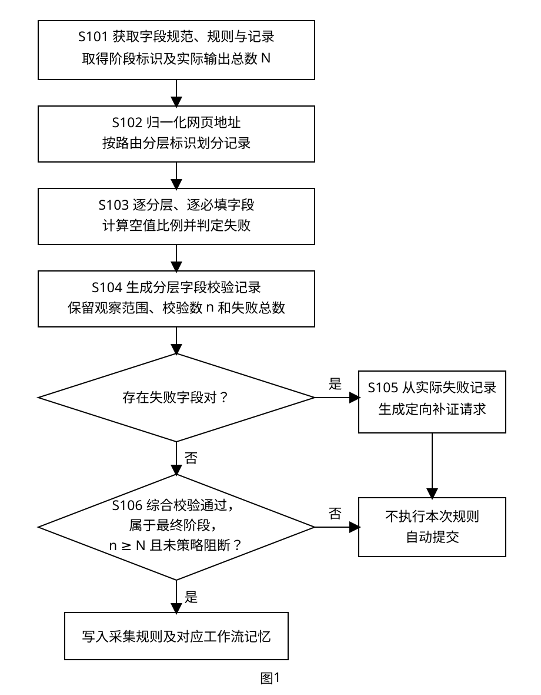
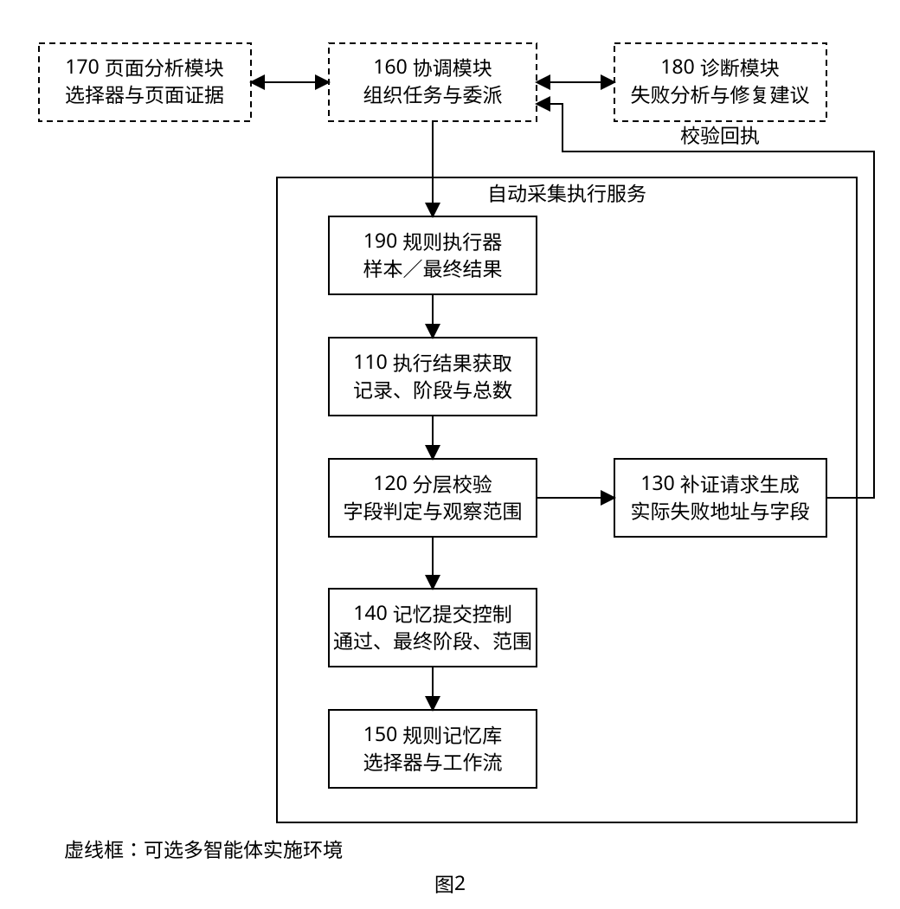

# 一种网页采集的分层验证与规则记忆控制方法

版本：V1／2026-10-29，供申请人审阅与代理师进一步检索、修改。

> 审阅说明，不属于拟提交技术正文：本稿依照中国发明专利文件的内容结构编排，包含权利要求书、说明书、摘要和附图；不是已提交申请，也不是授权意见。申请人、发明人、权属、公开时间及正式请求书尚待真实核对。撰稿日期不等于申请日。Markdown 与 SVG 是审阅载体，正式提交前还需按办理系统要求拆分和排版。
>
> 本稿主张对象是自动采集工作流内的分层字段校验、补证请求生成与规则记忆提交控制，不主张已完成知识图谱记忆、模型自主修复、自动补证硬预算或全站语义正确性证明。区别与组合风险单独见[逐项分析](AutoSpider_权利要求逐项对照与组合启示_V1.md)，不混入技术正文作授权保证。

## 一、权利要求书

### 权利要求1

一种网页采集的分层验证与规则记忆控制方法，应用于具有采集规则自动提交功能的网页采集工作流，其特征在于，包括：

获取采集字段规范、采集规则、根据所述采集规则执行得到的采集记录集合、执行阶段标识以及实际输出总记录数，其中，所述采集字段规范包括非空的必填字段集合，所述采集记录具有用于分层的有效网页地址，所述执行阶段标识用于区分样本阶段与最终阶段；

根据所述网页地址的主机名、归一化后的路径以及查询参数键构造路由分层标识，将所述采集记录按所述路由分层标识划分为多个记录分层；

针对每个已观察到的记录分层与每个必填字段组成的分层字段对，确定分层记录数和字段空值数，并计算字段空值比例；在任一分层字段对的字段空值比例超过预设阈值时，将该分层字段对确定为失败字段对，并将当前校验结果确定为不通过，使所述失败字段对不因总体字段统计满足总体阈值而被判为通过；

生成分层字段校验记录，所述分层字段校验记录包括已校验记录数、各分层字段对的统计结果、失败字段对总数以及表示所述统计结果仅针对已观察记录的范围信息；

当存在失败字段对时，依据至少一个失败字段对所在记录分层中的实际失败记录，生成补证请求，所述补证请求包括该记录分层的标识、失败字段、从所述实际失败记录取得的网页地址、页面作用域以及分析范围参数；

在所述网页采集工作流的自动提交路径中，以所述当前校验结果、执行阶段标识和已校验记录数控制所述采集规则的记忆提交，仅在所述当前校验结果为通过、当前结果属于最终阶段、已校验记录数覆盖所述实际输出总记录数且未触发访问策略阻断时，将所述采集规则及对应工作流写入规则记忆库；否则，不执行本次采集规则的自动提交。

### 权利要求2

根据权利要求1所述的方法，其特征在于，构造所述路由分层标识包括：对主机名进行大小写规范化；将路径中的整数标识、通用唯一标识符以及符合预设标识模式的路径段替换为对应的类型占位符；将查询参数键去重并排序，且不将查询参数值写入所述路由分层标识；所述补证请求中的网页地址保留对应实际失败记录的查询参数值。

### 权利要求3

根据权利要求1所述的方法，其特征在于，将字段缺失、字段值为 null 以及字段值为空字符串或仅含空白字符的情况确定为字段空值；对于记录分层 s 与必填字段 f，按 q(s,f)=z(s,f)/n(s) 计算所述字段空值比例，其中 n(s) 为所述记录分层的已观察记录数，z(s,f) 为其中所述必填字段的空值数；在 q(s,f) 大于所述预设阈值时产生阻止校验通过的字段质量问题。

### 权利要求4

根据权利要求1所述的方法，其特征在于，从实际失败记录取得补证网页地址包括：建立网页地址与在该地址对应记录中提取为空的失败字段之间的映射；初始化尚未覆盖的失败字段集合；迭代选择覆盖尚未覆盖失败字段数量最多的网页地址，并从所述集合中移除被覆盖的失败字段，直至所述集合为空、不再存在新增覆盖或达到预设地址数量上限；对仍保留在所述补证请求中的网页地址不进行字符串截断。

### 权利要求5

根据权利要求4所述的方法，其特征在于，所述地址数量上限为两个；每次校验生成的补证请求不超过八个，每个补证请求携带的分析范围参数包括样本数量上限和分析字符数上限，所述样本数量上限不超过三，所述分析字符数上限不超过四千；所述补证请求不包含从记录中抽取得到的文章正文，且补证请求数量达到上限不改变依据全部已观察分层计算的校验结果和失败字段对总数。

### 权利要求6

根据权利要求1所述的方法，其特征在于，所述分层字段校验记录包含针对已观察分层的字段符合性标志，所述字段符合性标志在记录集合非空且不存在失败字段对时为真；与所述字段符合性标志分开设置执行结果验证范围标志，所述执行结果验证范围标志依据已校验记录数与实际输出总记录数的比较结果确定；所述字段符合性标志为真而所述执行结果验证范围标志为假时，仍不执行本次采集规则的自动提交。

### 权利要求7

根据权利要求1所述的方法，其特征在于，当请求的记录上限大于预设样本数量或未设置记录上限时，先执行样本阶段的采集及校验，样本阶段校验不通过时不进入最终阶段，样本阶段校验通过时执行最终阶段的采集及校验；当请求的记录上限不大于所述预设样本数量时，直接执行最终阶段的采集及校验，且不将仅属于样本阶段的校验结果作为自动提交的依据。

### 权利要求8

根据权利要求1所述的方法，其特征在于，在确定所述校验结果及失败字段对总数之后，生成向协调模块返回的校验回执；当所述校验回执超过预设序列化字节上限时，优先省略通过校验的分层详情，再省略其他可变长度详情，并保留校验结果、已校验记录数和失败字段对总数以及详情省略提示；所述详情省略不重新计算或改变用于所述自动提交的校验结果。

### 权利要求9

一种网页采集的分层验证与规则记忆控制系统，其特征在于，包括：

执行结果获取模块，用于取得采集字段规范、采集规则执行所得记录集合、样本阶段或最终阶段的执行阶段标识以及实际输出总记录数，所述采集字段规范包括非空的必填字段集合，所述采集记录具有用于分层的有效网页地址；

分层校验模块，用于根据主机名、归一化路径和查询参数键对所述记录集合分层，针对各已观察分层与必填字段计算空值比例，在任一空值比例超过阈值时确定失败字段对并阻止当前校验结果为通过，以及生成包括已校验记录数、分层字段统计、失败字段对总数和已观察范围信息的分层字段校验记录；

补证请求生成模块，用于依据失败字段对所在分层的实际失败记录，生成包含分层标识、失败字段、实际失败网页地址、页面作用域和分析范围参数的补证请求；

记忆提交控制模块，用于在自动提交路径中，仅在所述校验结果为通过、当前结果属于最终阶段、已校验记录数覆盖实际输出总记录数且未触发访问策略阻断时，将所述采集规则及对应工作流提交至规则记忆库，否则不执行本次自动提交；

其中，所述分层校验模块的失败判定独立于总体字段统计是否满足总体阈值，并且所述分层校验模块输出的校验结果同时用于控制补证请求的生成和所述采集规则的自动提交。

### 权利要求10

一种计算机设备，包括存储器和处理器，所述存储器中存储有计算机程序，其特征在于，所述处理器执行所述计算机程序时，实现权利要求1至8中任一项所述的方法。

### 权利要求11

一种计算机可读存储介质，其上存储有计算机程序，其特征在于，所述计算机程序被处理器执行时，实现权利要求1至8中任一项所述的方法。

### 权利要求12

一种计算机程序产品，包括计算机程序，其特征在于，所述计算机程序被处理器执行时，实现权利要求1至8中任一项所述的方法。

## 二、说明书

### 技术领域

[0001] 本发明涉及网络数据采集与计算机程序执行控制技术领域，尤其涉及一种对网页采集记录执行分层字段验证、生成定向补证请求并控制采集规则记忆提交的方法及系统。

### 背景技术

[0002] 网页采集系统可根据用户给出的网页地址和字段要求生成选择器、页面跳转规则及分页规则，并在执行后检查结果。部分系统采用样本采集与结果校验，再执行较大范围任务；部分系统保存网站规则，以便后续请求复用。

[0003] 申请公开号为 US20090204889A1 的专利文献公开了根据抽取时出现的空属性与模板变异关系选择补充标注页面的方案；授权公告号为 CN121167008B 的专利文献公开了基于网页预处理与大模型生成规则，并对列表页及详情页候选规则进行测试选择的方案。申请公开号为 CN122112328A 的专利文献还涉及结果检验及将规则与网站关联存储。此处仅列出有关技术公开，不对其现行法律状态作判断。

[0004] 当一次任务涉及多种路由或页面布局时，数量占比较小的一组页面可能在必填字段上集中失效。例如，大多数页面的正文选择器有效，少数页面保留能匹配但内容为空的旧占位节点。执行器可正常返回记录，而少数页面的空字段在总体统计中占比不足以触发失败。仅检查选择器是否匹配或总体空值率，可能不能识别该组页面的集中失效。

[0005] 另一方面，校验记录集合可能只是样本或最终输出的一个前缀。该集合通过质量校验，并不意味着全部最终输出均已经验证。如果将局部校验通过直接作为规则记忆提交条件，可能使验证范围不足的规则被保存并在后续任务中重复使用。

[0006] 因此，需要在自动采集工作流中，将已观察分层的字段质量、实际失败记录指向的补证范围以及最终输出的验证范围共同用于执行控制，避免仅凭总体统计或局部通过标签进行自动记忆提交。

### 发明内容

#### 要解决的技术问题

[0007] 本发明要解决的技术问题是：对于包含不同路由记录的网页采集输出，如何识别已观察少数分层中的必填字段集中失效，以实际失败记录生成可执行的定向分析目标，并阻止样本或部分结果的校验通过被误用于最终采集规则的自动记忆提交。

#### 技术方案

[0008] 为解决上述技术问题，本发明在自动工作流中设置执行结果获取模块110、分层校验模块120、补证请求生成模块130以及记忆提交控制模块140，并通过规则记忆库150保存经控制路径允许提交的规则及工作流。上述模块可运行于同一计算机进程或经接口协同的计算机服务中。

[0009] 执行结果获取模块110获得字段规范、采集规则、执行阶段标识、实际输出总记录数和供本次校验使用的记录集合。字段规范包含字段名称、必填标记以及列表页、详情页或单页等页面作用域。采集规则包含条目选择器、字段选择器及页面导航操作，可由预定义执行器执行。

[0010] 分层校验模块120从记录中取得用于分层的网页地址，依据主机名、归一化路径和查询参数键生成路由分层标识。标识相同的记录进入同一分层。路由分层是页面结构的近似分组依据，不等同于已经识别全部真实页面模板。

[0011] 对于每个非空分层 s 和必填字段 f，计算分层记录数 n(s)、字段空值数 z(s,f) 以及 q(s,f)=z(s,f)/n(s)。当 q(s,f) 超过阈值时，形成失败字段对，并使本次结果不能通过质量校验；总体统计合格不消除该失败。

[0012] 分层字段校验记录表示本次实际观察的范围，保留各层统计及失败字段对总数。该记录中的字段符合性标志与最终输出的验证范围标志分开确定，不将样本内部字段合格解释成最终输出已完整验证。

[0013] 补证请求生成模块130依据失败字段对，从同分层的实际失败记录选择代表网页地址，输出分层标识、失败字段、页面作用域和分析范围参数。路由标识可省略查询参数值，而代表网页地址保留原始查询值，以维持实际补证目标的可执行性。

[0014] 记忆提交控制模块140在自动工作流内同时检查质量校验结果、当前执行阶段、已校验记录数相对于实际输出总记录数的覆盖情况以及访问策略阻断状态。不满足条件时不自动提交本次规则；满足条件时调用规则记忆库150的提交接口。

#### 有益效果

[0015] 在路由分组能够区分已观察失败页面的情况下，逐分层字段判定能够识别被总体空值比例掩盖的集中失效，降低该类错误结果被自动判为通过的风险。

[0016] 补证目标从实际失败记录选取，失败分层与失败字段共同限定分析范围，不必在请求中附带已经抽取的文章正文。分组标识与可访问地址采用不同表示，避免为归一化分组而破坏补证地址。

[0017] 质量判定与执行结果验证范围分开处理，可阻止仅有样本或前缀验证依据时自动提交对应最终工作流。该控制保护的是本次实际输出范围，不意味着能够证明未访问页面、漏掉的列表项或整个网站均已覆盖。

[0018] 在向协调模块返回校验结果时，可在保留失败判定和总数的前提下省略详情，限制回执体积而不把失败改为通过。上述效果不以采用特定大模型、MCP 接口或图数据库为前提。

### 附图说明

[0019] 图1为本发明的方法流程示意图；图2为本发明的系统模块及多智能体实施环境示意图。图1作为摘要附图候选。

[0020] 附图标记：110，执行结果获取模块；120，分层校验模块；130，补证请求生成模块；140，记忆提交控制模块；150，规则记忆库；160，协调模块；170，页面分析模块；180，诊断模块；190，规则执行器。S101至S106为方法处理步骤。

### 具体实施方式

#### 实施例一：任务、记录和执行结果的取得

[0021] 计算机服务接收一个采集任务。任务字段规范包含 url、title、content 三个必填字段，其中 url 表示记录关联的网页地址，content 为详情页正文。系统将采集规则组织为结构化计划，由固定执行器190执行打开页面、条目遍历、详情页访问及字段提取等预定义操作。

[0022] 一个具体实现使用任务规范、页面模型和执行计划分别表示采集合同、页面选择证据及执行操作；它们可分别对应 CrawlSpec、PageModel 和 CrawlPlan。模型或人工可提供选择器证据，执行器按照结构化计划工作，而非由每次任务任意生成一份新爬虫程序。

[0023] 执行服务返回执行标识、阶段标识、实际输出总记录数 N 和结果文件位置。本次校验取得的记录集合为 R，实际校验条数为 n。N 取自本次执行输出，不取任务允许的最大条数，也不取尚未访问的候选页面总数。

[0024] 在使用样本阶段的实现中，先对部分记录执行校验；样本失败时不进入最终阶段。样本通过后重新按最终任务边界执行并校验最终输出。对于记录上限不超过样本数量的小任务，直接以最终阶段执行一次，不再重复进行样本与最终两次采集。

#### 实施例二：路由分层及字段判定

[0025] 步骤S101，取得 R、字段规范、执行阶段标识和 N。此实施例的 R 中记录均具有有效网页地址，必填字段集合非空；无有效地址或无地址字段的退化情况见后续边界说明。

[0026] 步骤S102，将地址主机名规范化为小写，去除末尾点；对路径段中的整数、UUID 及符合预设模式的含数字长标识进行类型化替换。数字文件名可保留扩展名。例如，`https://EXAMPLE.com/news/1001.html?lang=zh&id=1001` 可得到 `example.com/news/{n}.html?id,lang`。

[0027] 查询参数键去重、排序并参与标识，查询参数值不参与标识。原始地址单独保留，不用归一化后的字符串替代实际访问地址。路径大小写、标识模式的具体规则可依据被采集站点约定配置，但不因分组近似而宣称同层必然具有完全相同的 DOM。

[0028] 步骤S103，遍历已观察分层与必填字段。缺少字段键、值为 null、空字符串或仅含空白字符时，计入相应空值数。每层至少包含一条已观察记录，因此分母 n(s) 大于零。

[0029] 以阈值 τ=0.2 为例，q(s,f)>0.2 产生失败字段对；q(s,f)=0.2 不因该分层条件单独失败。最终质量判定仍可同时包含字段键覆盖、总体空值比例、重复率和其他格式／语义规则；任一高严重度问题均可阻止通过。

[0030] 步骤S104，生成包括层标识、n(s)、z(s,f)、q(s,f)、必需字段对数和失败字段对总数的校验记录，并将作用范围标记为 observed_records。字段符合性标志在 R 非空且失败字段对数为零时为真；该标志只表达本次输入集合的分层字段情况，不能代替所有质量条件的最终通过结果。

#### 实施例三：实际失败记录驱动的补证请求

[0031] 步骤S105，对失败分层收集失败字段。对于该层中的每个实际网页地址，记录该地址对应记录在哪些失败字段上为空。初始化未覆盖失败字段集合，每次选择对该集合新增覆盖最多的地址，选入后移除已覆盖字段，直至集合为空、无新增覆盖或达到地址数量上限。

[0032] 例如，同一层三条记录分别为：地址A仅 title 为空，地址B的 title 和 content 均为空，地址C仅 content 为空。若失败字段集合为 title、content，优先选择地址B即可给出同时包含两种失败的分析目标。若字段失败分散在不同记录中，可选择两个地址。

[0033] 选择地址的依据是已发生的字段空值与该记录的关联，不是从任意正常页面猜测一个失败页面。地址保留查询参数值；例如分组标识为 `example.com/special/{n}?id`，补证目标可保留为 `https://example.com/special/1008?id=actual`。

[0034] 一种请求结构包括 stratum、fields、representative_urls、page_scope、max_samples、max_chars。一个具体实现对每层最多保留两个地址，每次报告最多输出八个补证请求，单请求样本上限不超过三、字符上限不超过四千。请求数达到上限时，其他已观察失败仍计入总数并阻止校验通过。

[0035] 请求中的分析范围参数用于向后续分析方声明待查看的页面、字段和输出范围；仅生成这些参数并不等于服务端已完成累计访问预算执行。请求不复制采集结果中的文章正文，但网页地址本身仍应按部署中的数据安全规则处理，不据此宣称完全不含敏感信息。

[0036] 协调模块160可将补证请求交给人工或诊断模块180；取得新的选择器证据后创建新的采集草稿，再执行并校验。此方法不要求模型必然修复成功，也不要求自动抓取补证资源或只重跑受影响层。前一次规则不会因收到修复建议而直接获得通过资格。

#### 实施例四：验证范围与自动记忆提交

[0037] 步骤S106，将阶段、质量结果与验证范围共同用于自动提交控制。在一个实现中，`phase=full` 表示最终阶段，`validation.status=PASS` 表示综合校验通过，`metrics.record_count` 表示 n，执行结果的 `record_count` 表示 N。

[0038] 当 n≥N 时，将执行结果验证范围标志设为真；当 n<N 时，返回仍需完整验证的状态，不自动提交本次规则。由于两种计数在这里均针对同一执行结果，通常有 n≤N；使用覆盖比较并不宣称允许用无关结果的记录数填补当前执行的缺口。

[0039] 例如，结果文件有1500条记录，而自动校验只读取前1000条，即使已读取部分的总体及分层统计均通过，也不允许按该报告自动提交最终工作流。此实现可以返回 needs_full_validation，等待对完整输出另行校验；本实施例并未包含一个已经实现的1500条流式复验器。

[0040] 对于最终阶段、完整范围且通过质量判定的结果，自动流程调用记忆接口，保存页面模型、选择器、执行计划、任务规范摘要、对应任务标识及校验评分。记忆库可按站点检索规则与工作流，供后续兼容请求调用。

[0041] 对于校验失败、范围不足、仍处于样本阶段或访问策略阻断的结果，自动流程不调用本次规则的提交操作。字段空值失败与网络许可失败应区分处理；访问策略阻断不应作为选择器错误触发更换访问方式。

[0042] 该提交门控限定于所述自动工作流路径。若部署还暴露兼容历史调用的手工记忆接口，则应单独核验该接口的合同；本方法不因自动路径具备上述门控而宣称任意外部调用均具备不可伪造报告、全局强制权限或跨进程事务保证。

#### 实施例五：有界校验回执与多智能体实施环境

[0043] 综合校验及记忆提交决定先在服务内完成，再生成供协调模块160读取的回执。一个具体实现将完整结果保存在文件，只返回状态、指标、任务句柄、文件位置和有界详情，避免把全部正文重复传入模型上下文。

[0044] 当序列化回执超过预设上限时，先移除字段均满足阈值的分层详情，再移除其他分层详情、问题详情或补证请求等可变长度项，直至符合上限。保留质量状态、已校验记录数、失败字段对总数和省略说明；保留下来的补证地址不作字符串截断。一个实施上限为16000个UTF-8字节，数值可按部署合同确定。

[0045] 详情省略不修改完整校验时已计算的判定。即使模型未看到某个失败分层的展开内容，该失败仍计入校验结果，自动提交条件不因回执缩小而放宽。

[0046] 在多智能体环境中，协调模块160可由 crawler-lead 承担，页面分析模块170可由 web-analyst 承担，诊断模块180可由 qa-repair 承担，模块之间可经MCP工具接口交换结构化参数与回执。复杂新站才委派分析，校验失败后才委派诊断，不要求每次任务同时启用全部角色。

[0047] 分层校验模块120与记忆提交控制模块140由确定性程序执行，不将语言模型一句“通过”直接作为替代。分析角色返回选择器证据或修复建议，协调方组织下一次草稿执行。角色名称、模型供应方、数据库产品及通信协议不是分层门控原理的必要条件。

#### 实施例六：少数路由空正文的受控执行例

[0048] 本实施例采用本地构造页面验证控制流程。列表包含10个条目，前8个指向 `/news/{n}.html`，正文位于 `.content`；后2个指向 `/special/{n}.html`，正文位于 `.alternate`，同时保留空的 `.content` 节点。各记录的标题与地址均有效且不同。

[0049] 用错误正文规则 `.content` 抽取时，执行器能够匹配后两页的旧节点并返回空值。10条记录、3个必填字段中的空单元格比例为2/30，正文全局空值比例为2/10。在允许20%正文空值的总体门限下，这组数据可被原总体规则判为通过。

[0050] 经本实施例分层后，`special` 层有2条记录，content字段空值比例为2/2，超过阈值0.2；形成1个失败字段对，质量结果为不通过，并生成指向实际special页面、字段为content、作用域为detail的补证请求。自动工作流不提交该错误规则。

[0051] 采用前5条为样本时，样本仅含news记录，可先通过；最终10条验证时仍因special层失败被阻断。采用位置0、2、5、7、9的5条边界分散样本时，本例在样本阶段即观察到special失败，从而不进入最终阶段。分散样本只是可选取样策略，不是分层判定的必要条件，也不保证覆盖全部少数模板。

[0052] 将规则改为能够取得两类正文的 `.content, .alternate` 后，新草稿重新执行样本和最终阶段，10条正文均正确取得，所观察分层通过，且最终已校验记录数覆盖本次实际输出记录数，自动流程提交修正后的规则。此例中的修正规则由测试预先给出，不作为模型自主修复成功率证据。

[0053] 本地执行中，错误规则采用前缀样本的流程发生2次列表请求和15次详情请求；采用上述分散样本的流程发生1次列表请求和5次详情请求。此差异由本例条目排列与样本失败早停产生，不表示实际网站均有相同比例的费用或时延改善。

#### 实施边界与其他实现形式

[0054] 同路由可能混有不同模板，不同路由也可能共用模板。若路由分组不能隔离失败，分层门控可能仍不能发现少数失效。该方法只检查已观察记录，不能证明漏项、未访问模板或内容语义全部正确；阈值允许一定比例空值，也不是逐记录零缺失保证。

[0055] 当记录缺少可用于分层的有效网页地址时，可在实现中返回缺失地址分层或总体层，但不能依该退化结果声称已经得到可访问的定向补证目标。完整的实际地址驱动处理以本说明书前述输入条件为前提。

[0056] 本方法可由计算机设备的处理器执行程序实现，程序可以存储于计算机可读存储介质，也可以作为计算机程序产品提供。系统模块为功能划分，不要求独立物理硬件。存储器保存任务、规则、结果及校验数据，处理器执行分层、统计、请求生成与条件提交。

## 三、说明书摘要

本发明公开一种网页采集的分层验证与规则记忆控制方法，属于网络数据采集技术领域。获取采集规则执行所得记录、必填字段及实际输出总记录数；按网页地址的主机名、归一化路径和查询参数键构造分层，逐层计算必填字段空值比例；对超阈值字段形成失败判定，并从实际失败记录生成包含原始网页地址、字段和分析范围的补证请求；在自动执行流程中，只有最终阶段校验通过且已校验记录数覆盖实际输出记录数时，才提交规则记忆。该方法用于降低少数路由字段失效被总体统计掩盖及局部验证结果被误用于整体规则记忆提交的风险。

摘要附图候选：图1。

## 四、说明书附图（审阅矢量版）

图1　方法流程示意图

图2　系统及多智能体实施环境示意图

---

审阅附注：上文为初稿技术内容，不代表所有权利要求均具备已确认的授权基础。方法独立项与系统独立项围绕同一控制链，申请前还需代理师核对清楚性、支持、单一性、必要特征与现有技术。正式请求书及摘要附图的提交规格在[阅读说明](README.md)列为待办，不虚构申请人、发明人或申请号。
